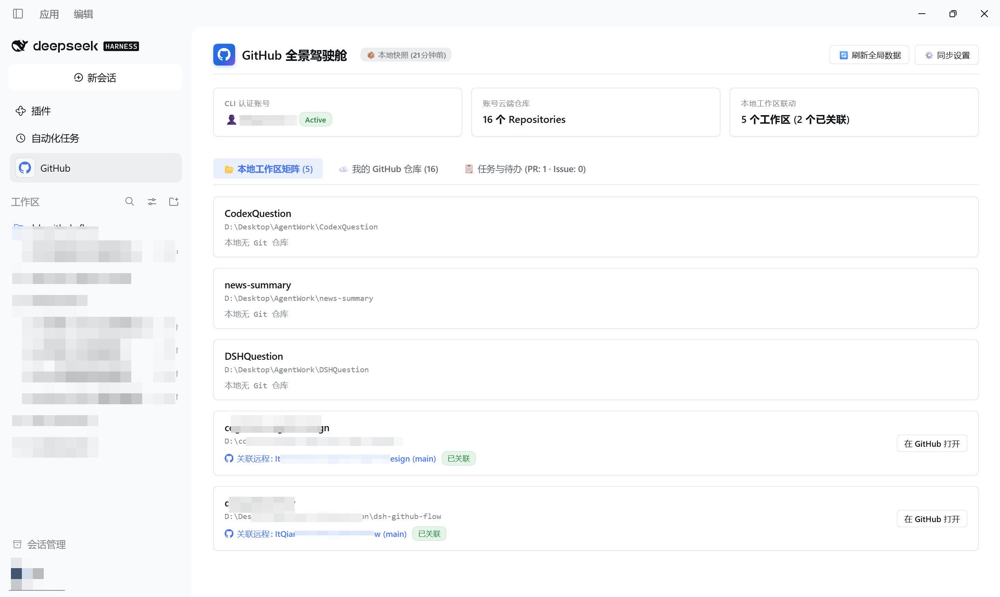
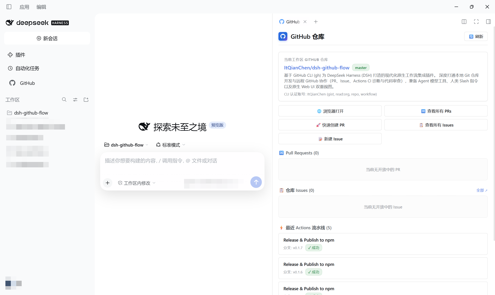
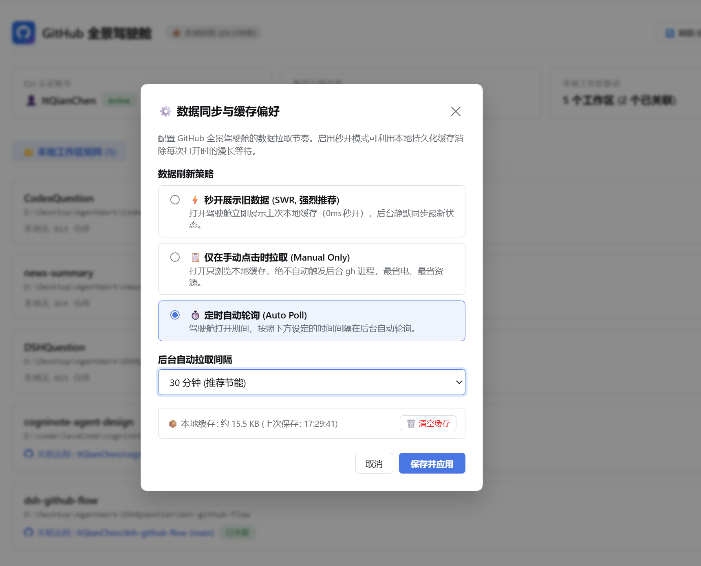
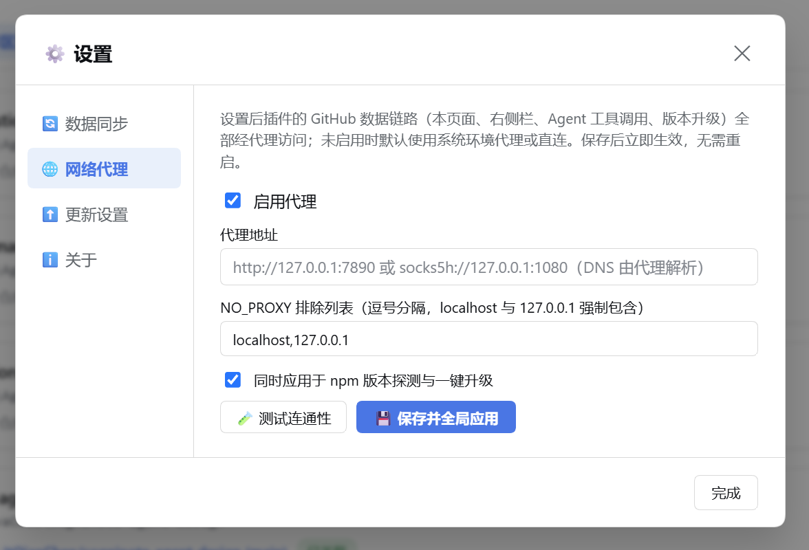

# DSH GitHub Flow (`dsh-github-flow`)

<p align="center">
  <a href="https://www.npmjs.com/package/dsh-github-flow"></a>
  <a href="https://www.npmjs.com/package/dsh-github-flow"></a>
  <a href="./LICENSE"></a>
  <a href="https://deepseek-harness.github.io/deepseek-harness/"></a>
  
</p>

<p align="center">
  <b>Give DeepSeek Harness Agents native hands and feet to operate GitHub, crafting an immersive collaboration cockpit for developers.</b><br>
  Natively reuses host <code>gh</code> CLI login credentials to eliminate Personal Access Token (PAT) leaks; deeply bridges local Git workspaces with remote GitHub collaboration, equipped with <b>19 core domain Agent tools (106 actions covering PR review/Issue tracking/Actions workflow & cache governance/clone-free file reads/branch ruleset policy diagnosis/Gist snippets/labels & global status dashboards/secrets & variables/agent tasks/discussions/projects v2/codespaces/runtime telemetry)</b>, <b>pre-execution human approval plus a local operation log for every PR / Issue write (overridable per repo and per action)</b>, <b>human slash commands</b>, <b>Web UI visual cockpits</b>, and <b>cross-platform one-click seamless upgrades</b>.
</p>

<p align="center">
  <b><a href="./README.md">简体中文</a></b> | <b>English</b>
</p>

---

## 🎯 Why `dsh-github-flow`?

When using AI Agents for collaborative coding, developers frequently hit these fragmentation friction points:

| Collaborative Scenario | Traditional Approach (Friction-Heavy) | `dsh-github-flow` (Native Experience) |
| :--- | :--- | :--- |
| **Agent PRs & Code Review** | Manually push branch in browser, click through GitHub web pages to open PRs, breaking autonomous loops. | **Autonomous PRs & Reviews**: Just tell the Agent *"Create a PR for this branch"*; Agent calls `github_pr` to publish and review diffs automatically. |
| **Agent touched my PR / Issue — can't stop it beforehand, can't audit it afterwards** | `confirm: true` is a parameter the *model* fills in: nothing verifiable sits between "the user said yes" and "the model claims yes". When it goes wrong you dig through chat history. | **Pre-execution approval + local operation log**: merges / closes / deletes / transfers go through DSH's official approval prompt before they run — approve and it proceeds, reject and the tool fails on the spot, handing "confirm the intent first" back to the model. Every write leaves a local record you can query, delete and export (including the exact title and body submitted at the time). Both can be overridden per repo and per action, and both can be switched off entirely. |
| **CI / Actions Failure Debugging** | Sifting through pages of Actions logs in a browser, copying stack traces to chat for debugging. | **Pinpoint Error Extraction**: Tell the Agent *"Why did CI fail?"*; Agent calls `github_run(log_failed)` to grab failed step logs and patch code instantly. |
| **Security & Token Management** | Pasting plain-text Personal Access Tokens (PATs) in plugin configs, risking token leaks and permission sprawl. | **Zero Token Exposure**: Directly reuses local `gh auth login` credentials via native OS Keychains/Keyrings securely. |
| **Context Switching Overhead** | Jumping back and forth between VS Code, browser GitHub tabs, and DSH chat windows. | **Immersive Dual Cockpit**: Live PR status, Actions pipelines, and 3D issue matrices right inside DSH. |
| **Branch Switching & Real-Time Sync** | Switching branches requires hopping into a terminal, while the sidebar remains stale regarding local stage/commit changes. | **Safe In-UI Branch Switching + Live Git Watch**: Instant keyword filter with uncommitted dirty change guard; 800ms debounced `.git` watcher aligns right sidebar in milliseconds. |
| **First-Screen Latency & Loading** | Staring at full-screen spinners for 8~15s while waiting for heavy background `gh` processes. | **SWR 0ms Instant Render + Scheduled Sync**: Instantly displays local persistent snapshots; features a 3-way mutually exclusive sync model (SWR, Cloud Auto-Sync with visibility pause, Manual) and standalone local Git watch. |
| **Plugin Upgrades & Maintenance** | Manually checking npm registry versions, complicated commands, fear of breaking configs. | **Idle Silent Detection + One-Click Upgrade**: Dual-registry acceleration, auto macOS/Windows adaptation, upgrade with one click. |

---

## 🚀 Installation Guide

### Step 1: Prerequisites
Ensure GitHub CLI (`gh`) is installed and authenticated:
```bash
# Windows
winget install --id GitHub.cli

# macOS
brew install gh

# Login (one-time setup)
gh auth login
```

### Step 2: Install into DSH

Run in your DSH environment:

```bash
# Scenario A: DSH Desktop Edition (Desktop Profile)
dsh plugin --profile desktop add dsh-github-flow

# Scenario B: DSH Web / CLI Environment (--profile is required by the official CLI; fill in your actual profile name)
dsh plugin --profile web add dsh-github-flow
```

> 💡 **Notice (24-Hour Supply-Chain Security Lock Window)**:  
> DSH's bundled package manager enforces a supply-chain safety policy (`minimum-release-age = 24h`) by default to mitigate malicious package takeovers. Within **24 hours** of a new version release, running bare-name install commands without a version suffix will automatically fall back to the preceding stable version that has matured past 24 hours. To **install a newly released version immediately**, append the explicit version tag:
> ```bash
> dsh plugin --profile desktop add dsh-github-flow@<latest-version>
> ```
> Once 24 hours have passed since release, the standard bare-name command will resolve to the latest version automatically.

---

## 🤖 Core Agent Tools: Equipping Agents with Native GitHub Powers

Consolidates scattered GitHub endpoints into **19 core domain tools (106 actions)**, featuring **Token Budget Protection (default 24KB intelligent truncation)**, **High-density Native Markdown Rendering (70%+ list output token reduction)**, **OAuth Scope self-healing guidance**, and **Zero-argument CWD auto-binding**.

### 0. `github_task`: Task-level Primitives (🆕 new in v0.7.0)
> **Example Agent Prompts**:
> - *"Review PR #12, focus on security"*
> - *"Why did CI fail?"*
> - *"What should the next version be? Draft the notes"*

The 19 domain tools above are a **verb table** (list / view / diff / checks / review…), while users speak in **tasks**. `github_task` wraps the three most repeated journeys into **one call** and returns an already-trimmed, directly actionable envelope:

```text
summary (≤1.5KB) + facts (structured) + nextActions (concrete next steps) + cost (chars / gh calls / elapsed)
```

* **`review_pr`**: PR metadata + head SHA + changed-file diffs (trimmed by `budget_chars`) + CI tri-state + repository `AGENTS.md` review rules + existing line-comment count — in one shot.
  * `focus: 'security' | 'correctness' | 'perf' | 'style'` only changes the wording of the conclusion, not what is fetched.
  * **Read-only by default**; writing a review back requires `write: true, confirm: true` (the gate returns a confirmation payload first).
* **`diagnose_ci`**: takes `run_id` or `pr_number` → locates failing jobs/steps → extracts failure-log anchors by framework → lists suspected files. When the log is truncated, `truncated.totalUnknown = true` — **do not conclude "that's all the failures"**.
* **`prepare_release`**: commits since the last tag → Conventional Commits grouping → SemVer suggestion (breaking→major / feat→minor / else→patch) → release-notes draft + health check (clean tree / synced / CI green).
  * **This primitive never tags, pushes, or creates a Release**: releasing is a human decision; it only prepares "which version, what notes" and puts ready-to-run commands in `nextActions`.

> **Tier tip**: `toolsets: ['core']` is exactly "3 tasks instead of 15 domain tools" (`github_task` + `github_repo` + `github_help`, ~4,400 chars of schema — 84% smaller than full). Add `github_pr` / `github_run` explicitly when you need fine-grained control — primitives are shortcuts, not the only entrance.

### 1. `github_pr`: Pull Request Lifecycle & Automated Code Review
> **Example Agent Prompts**:
> - *"Check if there are any open PRs awaiting my review in this repository."*
> - *"Create a PR for the current branch titled 'feat: add dark mode' with a brief summary of changes."*
> - *"Review code diffs in PR #12 and provide security and refactoring suggestions."*
> - *"Did CI checks pass for PR #8? If so, squash merge it and delete the source branch."*

* **Supported Actions**:
  * `list`: List open PRs with author, review decisions, and CI status (`state` / `author` / `limit` filters);
  * `view`: Inspect PR description, metadata, and mergeability;
  * `diff`: Retrieve complete code diffs (`stat_only` for file-change overview, safely truncated against token limits);
  * `checks`: Audit CI gate status (pass/fail/skip category badges, owning workflow, and detail links);
  * `create`: Auto-create PRs (supports draft mode & `--dry-run`, supports `attach_images` local uploads);
  * `edit`: 🆕 Edit PR title, body description, and metadata with image attachment support;
  * `comment`: 🆕 Post comments and reviews to pull requests with image attachment support;
  * `checkout`: 🆕 Check out PR code to a local branch so the Agent can run tests in the local workspace (requires a clean working tree; an existing branch is not reset unless `force: true` + `confirm: true` are passed);
  * `status`: 🆕 Inspect merge conflict status (`CLEAN` / `CONFLICT`) for the current branch's PR;
  * `review`: Submit code reviews (`APPROVE`, `REQUEST_CHANGES`, `COMMENT`);
  * 🆕 **`review` + `comments` (line-level review comments, new in v0.7.0)**: `gh pr review` has no line-level flags, so this version adds a `comments` array backed by `POST /pulls/{n}/reviews`, posting multiple comments anchored to specific code lines in one request. **Without `comments` the behaviour is byte-for-byte identical to previous versions** (still `gh pr review`) — no write-back by default.

    ```jsonc
    // github_pr(action:'review', pr_number:12, review_decision:'COMMENT',
    //            body:'summary', comments:[{ path:'src/a.ts', line:42, body:'needs a lock here' }])
    // optional: side('LEFT'|'RIGHT', default RIGHT), start_line (multi-line), commit_id (pin to a SHA)
    ```

    Three boundaries: ① max **50** comments per review; ② `path`/`body` required and `line` must be a positive integer — validation reports **all** problems at once; ③ if a line is not on the commentable side of the diff (pure deletions, etc.) and GitHub returns **422**, the comments are **folded into the review body** (prefixed with `path:line`), retried once, and explicitly marked `degraded` — no content is lost.
  * 🆕 **Severity prefixes `[P0]` / `[P1]` / `[P2]` (new in v0.7.0)**: review bodies and every line comment pass through severity normalization before submission — **existing prefixes are preserved, a missing one gets `[P2]`, and `[P0]`/`[P1]` are never downgraded**. The goal is to keep a pile of P2s from drowning out the P0; the plugin only adds labels, it never rewrites your judgement.
  * 🆕 **Repository review rules from `AGENTS.md` (new in v0.7.0)**: `view` reads `AGENTS.md` from the workspace (repo root plus the nearest file in each changed file's directory, ≤8KB per file / ≤16KB total), extracts the `## Code Review Rules` section (falls back to the whole file when that heading is absent), returns it as `reviewRules`, and renders a "Repository review rules" section at the end of the Markdown output. **When no `AGENTS.md` exists the key is absent entirely** — "no rules" and "empty rules" stay distinguishable. Rules enter context only through tool output; nothing is injected into the system prompt.
  * 🆕 **Review anchors & visible truncation (new in v0.7.0)**: `view` now returns `headRefOid` / `baseRefOid` / `changedFiles`, and the Markdown branch line renders as `feat/x@a1b2c3d` (branch names move, SHAs don't); when the `files` list hits gh's 100-item cap it says so explicitly ("only the first N / M listed").
  * `merge`: Merge pull requests (`squash` / `merge` / `rebase`, optional `delete_branch`; requires `confirm: true`);
  * `ready`: 🆕 Toggle Draft ↔ Ready (`undo: true` converts back to Draft — fully reversible);
  * `revert`: 🆕 Create a revert commit (generates a new revert PR on the remote; requires `confirm: true`);
  * `update_branch`: 🆕 Sync the latest base-branch commits into the PR branch — the self-healing action for "branch is out-of-date" CI gate failures;
  * `view_images`: 🆕 Download PR discussion screenshots (body + comments; `image_urls` targeting with budget-overflow resume list);
  * `attach_images` (param): 🆕 Upload local images/attachments to PRs (up to 50 files/batch, symmetric with view_images, requires gh ≥ 2.99).
  * `body_file` (param): 🆕 PR and comment bodies can come straight from a local markdown file (`create` / `edit` / `comment` / `review`), mutually exclusive with `body`; relative paths resolve against the current workspace, the file must be valid UTF-8 (GBK/ANSI fails loudly), and bodies are capped at 65,536 characters — long bodies never enter the model context.

---

### 2. `github_issue`: Issue Tracking & Branch Creation
> **Example Agent Prompts**:
> - *"List all open issues assigned to me."*
> - *"Branch off a local fix branch 'fix-login-error' from Issue #42 and start working."*
> - *"Add a comment to Issue #15 summarizing the edge cases we just discovered with screenshots."*

* **Supported Actions**:
  * `list`: List issues with flexible filtering (`state` / `labels` / `assignees`);
  * `view`: Inspect full issue threads, body descriptions, and assignees;
  * `create`: Create new issue tickets (supports `attach_images` local uploads);
  * `comment`: Add comments to issue threads (supports `attach_images` error screenshot uploads);
  * `edit`: Update titles, `add_labels`, or `remove_labels`;
  * `close` / `reopen`: Manage lifecycle status (`close` requires `confirm: true`);
  * `develop`: 🆕 Automatically branch off a local Git branch linked to the issue;
  * `delete`: 🆕 Irreversible physical deletion (requires `confirm: true`);
  * `transfer`: 🆕 Move issue to another repository with 301 redirects (requires `confirm: true`);
  * `pin` / `unpin`: 🆕 Manage pinned issues on the repository;
  * `lock` / `unlock`: 🆕 Lock discussions with standard reasons (`off_topic`, `resolved`, `spam`, `too_heated`);
  * `status`: 🆕 Retrieve a comprehensive dashboard of issues assigned to the active user;
  * `view_images`: 🆕 Download screenshot attachments from issue descriptions and comments into local image blocks;
  * `attach_images` (param): 🆕 Upload local file screenshots alongside issues (up to 50 local files/batch, requires gh ≥ 2.99).
  * `body_file` (param): 🆕 Issue and comment bodies can come straight from a local markdown file, mutually exclusive with `body`; relative paths resolve against the current workspace, the file must be valid UTF-8, and bodies are capped at 65,536 characters.

---

### 3. `github_run`: Actions Monitoring & Intelligent Troubleshooting
> **Example Agent Prompts**:
> - *"Did the latest CI run on main fail?"*
> - *"Extract the failed step logs from the recent failed run and debug the root cause."*
> - *"Re-run the latest failed CI pipeline."*

* **Supported Actions**:
  * `list`: Query workflow runs by branch or status;
  * `view`: Inspect step breakdown and conclusion states;
  * `log_failed`: **🔥 Troubleshooting Swiss Army Knife**! Pinpoints exact failing jobs and steps, extracting only the critical failure lines;
  * 🆕 **Framework-aware anchor extraction (new in v0.7.0)**: the whole log is no longer dumped at the model. Failure markers from common frameworks (pytest `FAILED`, node `AssertionError`, Go `panic:`, tsc `error TSxxxx`, `npm ERR!`, …) are used to slice the log into **failure blocks** (each with a start line and following context; adjacent markers are merged), then trimmed to a character budget; when blocks exceed the cap it states "N blocks omitted (M total)". **If no known anchor matches it falls back to the last 200 lines** and says why (failures are concluded at the end of a log; the head is mostly environment setup).
  * For this, `log_failed`'s output budget is raised to **2MB chars / 8MB bytes** — otherwise the default 24K truncation happens *before* extraction and later failures never reach the context.
  * `rerun`: Re-trigger failed workflows with one click;
  * `cancel`: Cancel in-progress or queued runs;
  * `trigger`: Manually dispatch `workflow_dispatch` workflows with custom parameters;
  * `workflow_list`: 🆕 List all workflows in the repository (`all: true` includes disabled ones);
  * `workflow_view`: 🆕 Inspect workflow YAML definitions and total run metrics;
  * `workflow_enable` / `workflow_disable`: 🆕 Toggle workflow status dynamically;
  * `download`: 🆕 Download build artifacts (strictly adhering to GHSA path-traversal safeguards).

---

### 4. `github_repo`: Metadata, Fork Sync, Clone-Free File Reads & Global Search
> **Example Agent Prompts**:
> - *"Sync my fork with the upstream repository."*
> - *"Search where 'useAuthToken' is used across this repository."*
> - *"Read 'src/utils.ts' on the remote repository without cloning."*
> - *"Fetch the README, and download the architecture diagrams inside it."*

* **Supported Actions**:
  * `view`: Inspect repository metadata, default branch, Star/Fork counts, licenses, and topics;
  * `readme`: 🆕 Read README text and extract all referenced image URLs, with optional `image_urls` batch downloads;
  * `sync`: Sync fork branch with upstream (`--force` hard reset supported);
  * `read_file`: 🆕 Clone-free remote file reading (`gh ≥ 2.95` direct, older CLI versions auto-fallback to REST API);
  * `read_dir`: 🆕 Clone-free remote directory enumeration with file types and sizes;
  * `search_code`: Search code across GitHub repositories;
  * `search_repos`: Search repositories by keywords and topics;
  * `search_issues` / `search_prs`: Global issue and pull request queries;
  * `search_commits`: Global commit message search.

---

### 5. `github_release`: Release Governance & Build Artifact Delivery
> **Example Agent Prompts**:
> - *"Check the latest release notes and assets for this repository."*
> - *"Draft a new v0.4.0 release using commits since the last tag."*
> - *"Upload the local build artifact 'dsh-github-flow-0.4.0.tgz' to the latest release."*

* **Supported Actions**:
  * `list`: Query release history;
  * `view`: Inspect notes and asset manifests for a given tag;
  * `create`: Publish releases (supports `generate_notes`, drafts, prereleases, and asset attachments);
  * `notes_file` (param): 🆕 Release notes can come straight from a local markdown file (replaces `notes`, maps to `--notes-file -`), mutually exclusive with `notes`; relative paths resolve against the current workspace, the file must be valid UTF-8 (release notes do not use the 65,536-character body cap — only the 4MB file-size guard applies);
  * `upload`: Attach build assets to an existing release (`clobber: true` requires `confirm: true`);
  * `download`: Download release artifacts with glob pattern filters;
  * `delete`: Delete releases (`cleanup_tag: true` deletes associated Git tag; requires `confirm: true`).

---

### 6. `github_secret`: CI/CD Secrets & Variables Governance
> **Example Agent Prompts**:
> - *"List the names of all configured Actions secrets."*
> - *"Set a repository secret named 'DEPLOY_KEY'."*
> - *"Read the value of plaintext variable 'NODE_ENV'."*

* **Supported Actions**:
  * `list`: Enumerate secret or variable names (secret values are never echoed);
  * `set`: Configure secrets (**Security Invariant: ciphertext safely passed via stdin, never in command arguments or process tables**) or variables;
  * `get`: 🆕 Read variable values (available only for `kind: 'variable'`; secrets are cryptographically shielded by GitHub);
  * `delete`: Remove secrets or variables (secret deletion requires `confirm: true`).

---

### 7. `github_skill`: Agent Skills Ecosystem Discovery & Local Installation 🧪 Preview

> 🧪 **Preview dependency**: built on `gh skill`, which is currently in public preview (`subject to change without notice`); the command surface may change with gh releases.
> **Example Agent Prompts**:
> - *"Search GitHub for open-source Agent skills related to 'markdown'."*
> - *"Preview and install the code review skill from 'github/awesome-copilot' into this project."*

* **Supported Actions**:
  * `search`: Discover compliant Agent skills across open-source GitHub repositories;
  * `preview`: Preview `SKILL.md` rule instructions without installing;
  * `install`: Install skills locally (`scope: 'project'` or `'user'`; requires `confirm: true`);
  * `list`: Inspect installed skills in the current environment;
  * `publish`: 🆕 **Skill Compliance Validation & Publishing Loop**: Safe `--dry-run` inspection against agentskills.io specifications, `--fix` metadata stripping, and release publishing with required `tag` and `confirm: true`;
  * `update`: 🆕 **Batch Inspection & Sync Updates**: Safe `--dry-run` check comparing local and remote tree SHAs, with `--all` batch synchronization.

---

### 8. `github_help`: Comprehensive Mapping, Official Syntax & Self-Healing
> **Example Agent Prompts**:
> - *"I am not sure which tool manages Discussions; check the mapping table for me."*
> - *"What is the syntax for filtering GitHub search results by date?"*
> - *"How do I debug 'authentication failed' errors from gh?"*

* **Supported Actions**:
  * `overview`: Complete toolbox navigation and summary table (19 core tools);
  * `mapping`: **Official gh Command ↔ Tool Action Mapping Table**, detailing exact tool calls and REST/GraphQL fallback routes;
  * `search_syntax`: Date ranges, qualifiers, and boolean query syntax;
  * `troubleshooting`: Self-healing recipes for authentication loss, timeouts, SOCKS5 proxy configs, and permissions;
  * Domain guides: In-depth usage guides for `pr`, `issue`, `run`, `repo`, `release`, `secret`, `skill`, `label`, `ruleset`, `cache`, `gist`, `status`, `agent_task`, `discussion`, `project`, and `codespace`;
  * `gh_command`: Direct pass-through lookup of official gh manual entries (e.g. `gh_command: 'ruleset'`).

---

### 9. `github_api`: Raw GitHub REST & GraphQL Escape Hatch
> **Example Agent Prompts**:
> - *"Call GitHub API to fetch the current user's profile JSON."*
> - *"Run a GraphQL query to inspect repository Discussions."*

* **Supported Features**: Direct invocation of arbitrary GitHub REST or GraphQL endpoints using host credentials, supporting `--jq` filtering, auto-pagination (`paginate: true`), and `raw: true` mode.

---

### 10. `github_label`: Label System Management & Cross-Repo Cloning
> **Example Agent Prompts**:
> - *"List all labels in this repository sorted by name."*
> - *"Create a label 'priority/p0' with color #d73a4a for critical bugs."*
> - *"Clone the label system from 'cli/cli' repository into our new repository."*
> - *"Delete the deprecated 'invalid' label."*

* **Supported Actions**:
  * `list`: List repository labels (supports `search` regex/keyword, `sort: 'created' | 'name'`, and `order: 'asc' | 'desc'`);
  * `create`: Create a new label (hex color normalization, optional `force: true` to update existing);
  * `edit`: Update label color, description, or rename via `new_name`;
  * `delete`: Safe deletion (affects associated issues/PRs; requires `confirm: true` confirmation, injects `--yes`);
  * `clone`: 🆕 **One-click cross-repo label cloning**: Copy all labels from a source repository (`source_repo`) into the target repository (supports `force: true` to overwrite conflicts).

---

### 11. `github_ruleset`: Branch Protection Rules & Policy Diagnosis
> **Example Agent Prompts**:
> - *"Why can't I merge this PR? Check all applicable rules for this branch."*
> - *"Verify whether branch master requires CI status checks or 2 approvals."*
> - *"List all repository rulesets."*

* **Supported Actions**:
  * `check`: **🔥 Core PR Merge Blocker Diagnosis**! View all protective rules governing a branch (e.g. required approvals, required status checks, linear history, force-push denial), complementing `github_pr(action: 'checks')` with authoritative policy perspective;
  * `list`: List rulesets for repository or organization (`--org` and `--no-parents` support);
  * `view`: Inspect ruleset configuration and target branches (requires `ruleset_id`).

---

### 12. `github_cache`: Actions Build Cache Auditing & Safe Cleanup
> **Example Agent Prompts**:
> - *"How much cache space is consumed by GitHub Actions in this repository?"*
> - *"List build caches sorted by size in descending order."*
> - *"Purge all build caches in this repository."*

* **Supported Actions**:
  * `list`: Audit Actions caches with human-readable size formatting (KB/MB/GB), key prefix and ref filtering, and size/access sorting;
  * `delete`: Precise 3-way cleanup (by `cache_id`, by `key`, or purge everything via `all: true`; **all three paths require `confirm: true`**; purge additionally injects `--succeed-on-no-caches` for idempotency).

---

### 13. `github_gist`: Code Snippets & Diagnostics Archiving
> **Example Agent Prompts**:
> - *"Publish this diagnostic error log as a Secret Gist and share the link."*
> - *"List all gists on my user account."*
> - *"Inspect the contents of Gist '5b0e0062eb8e9654adad7bb1d81cc75f'."*

* **Supported Actions**:
  * `list`: List user gists (structured TSV parser, supports `public` / `secret` / `filter` options);
  * `view`: View raw code contents of a gist (optional `filename` targeting, requires `gist_id`);
  * `create`: Create gists from `content` string (streamed via safe stdin pipeline) or local `files`, defaults to Secret mode with **explicit unlisted security warnings**;
  * `edit`: Update descriptions or files in a gist;
  * `delete`: Permanently delete a gist (requires `confirm: true` and `--yes`).

---

### 14. `github_status`: Cross-Repository Todo & Runtime Health Dashboard
> **Example Agent Prompts**:
> - *"What tasks and pull requests need my attention on GitHub today?"*
> - *"Check recent @mentions and activity across all repositories I follow."*
> - *"Audit the runtime health score and degradation rate report of our GitHub tools."*

* **Supported Actions**:
  * `view`: **Account-level global status cockpit** (default), aggregating Assigned Issues, Assigned PRs, Review Requests, Mentions, and Repository Activity across all subscribed repositories without needing repository context; supports `-o` org filtering and `-e` noise repository exclusion;
  * `health`: 🆕 **Toolchain Runtime Health & Degradation Audit Report**: Powered by Cordis `tools/result` event telemetry, audits total calls, success rates, comprehensive health score (0-100), API degradation rates, and actionable self-healing upgrade suggestions across all 19 tools.

---

### 15. `github_agent_task`: Cloud Coding Agent Session Governance 🧪 Preview

> 🧪 **Preview dependency**: built on `gh agent-task`, which is currently in public preview (`subject to change without notice`); the command surface may change with gh releases.
> **Example Agent Prompts**:
> - *"List all GitHub Copilot Coding Agent task sessions assigned under my account."*
> - *"View task 'e2fa49d2' details and fetch its execution logs."*
> - *"Dispatch a task to the cloud Agent: 'Refactor network layer with retry support', based on branch develop."*

* **Supported Actions**:
  * `list`: List agent tasks (supports `-L/--limit`; `gh agent-task list` does not accept `-R/--repo`, which has no effect on this action);
  * `view`: View task session details and logs (supports `--log`, strictly requires `task_id` to prevent TTY hangs);
  * `create`: Create and dispatch a cloud agent coding task (supports `-b/--base` and `-a/--custom-agent`).

---

### 16. `github_discussion`: Team Discussions & Open-Source RFC Loop 🧪 Preview

> 🧪 **Preview dependency**: built on `gh discussion`, which is currently in public preview (`subject to change without notice`); the command surface may change with gh releases.
> **Example Agent Prompts**:
> - *"List open discussions in category 'Ideas' for this repository."*
> - *"View discussion #101 body and comment thread."*
> - *"Start a discussion under 'RFC': 'Proposal on telemetry observability'."*
> - *"Post a reply comment to discussion #101."*

* **Supported Actions**:
  * `list`: Query discussions (supports `-c/--category`, `-s/--state`, `--labels`, and `-S/--search`);
  * `view`: Read discussion body and replies (supports `--comments`, requires `discussion_number`);
  * `create`: Start a discussion (requires `category`, `title`, and `body`);
  * `edit`: Update discussion title or body;
  * `comment`: Post a comment reply to an existing discussion.

---

### 17. `github_project`: Projects v2 Board & Item Planning
> **Example Agent Prompts**:
> - *"List all Projects v2 boards under my account."*
> - *"View items in project board #1 with filter query 'is:open'."*
> - *"Add Issue 'https://github.com/owner/repo/issues/10' to project board #1."*
> - *"Create a draft issue item in project #1 titled 'Review unit test coverage'."*

* **Supported Actions**:
  * `list`: List user or organization projects (default `owner: '@me'`, natively handles `--format json`);
  * `view`: Inspect project metadata, visibility, description, and README;
  * `item-list`: Inspect board items (supports Projects query filter syntax `--query`, e.g., `is:open assignee:@me`);
  * `item-add`: Associate existing Issue/PR URLs to a project board;
  * `item-create`: Create draft issue items;
  * `item-delete`: Remove items from board (guarded by required `confirm: true`);
  * 🔑 **Scope Self-Healing**: Automatically renders a single-line self-healing command card (`gh auth refresh -s read:project`) when permissions are missing.

---

### 18. `github_codespace`: Cloud Remote Development Environment (MVP)
> **Example Agent Prompts**:
> - *"Check which cloud Codespace environments are currently running."*
> - *"Inspect instance specs and idle timeout for 'fuzzy-spoon-69vj'."*
> - *"Stop 'fuzzy-spoon-69vj' to avoid billable core-hour consumption."*
> - *"Permanently delete an unused temporary Codespace."*

* **Supported Actions**:
  * `list`: List Codespaces under current user or organization;
  * `view`: Inspect environment specs, DevContainer path, and status (requires `codespace` name);
  * `stop`: Stop running instances to halt billing immediately;
  * `delete`: Safely delete instances (requires `confirm: true`, passes `-f` for non-interactive execution);
  * 🔑 **Scope Self-Healing**: Automatically renders a single-line self-healing command card (`gh auth refresh -h github.com -s codespace`) when missing required scopes.

---

## 🖥️ Web UI Cockpit & Right Sidebar Workspace Panel

`dsh-github-flow` delivers native visual controls alongside its Agent toolset:

### 1. Global Cockpit (Main Dashboard)
Click the **Octocat icon** in DSH's left navigation bar to open the full-screen cockpit:
* **⚡ 0ms Instant Render (SWR Persistent Cache)**: Powered by local snapshot persistence; enjoy instant dashboard loading;
* **📦 Live Freshness Status Pill**: Transparently communicates data freshness right next to the title (`[📦 Local Snapshot (21m ago)]` ➔ `[⏳ Syncing in background...]` ➔ `[✅ Up to date (15:30)]` ➔ `[⚠️ Network failed, offline snapshot displayed]`);
* **Account-Wide Overview**: Live view of all cloud repositories, default branches, and star counts;
* **Local Workspace Matrix**: Automatically detects open projects and bridges local directories with remote repos;
* **3D Issue Governance Matrix**: Categorizes issues into *"📥 User Reported"*, *"🎯 Assigned to Me"*, and *"✍️ Created by Me"* with responsive pill filters;
* **Update Notification Banner**: Smoothly glides down when an update is available with one-click automated upgrade;
* **🔀 PR Review Workbench**: Click any PR to review author, branch flow, CI/review status, Markdown description, comment timeline, and the changed-file list with high-fidelity unified diffs — all without leaving DSH (diffs are sliced per file in memory, so switching files is instant);
* **📝 Issue Online Viewer**: Click any Issue to read the full discussion — body and comments rendered as Markdown, long content collapsed, GitHub-hidden (SPAM) comments explicitly flagged, with label chips, assignees, milestone, sub-issue progress, and linked PRs.
* **⚡ Actions Run Online Detail**: Click any run card in the sidebar to inspect workflow / branch / commit / trigger event / duration plus the full job & step tree (per-step conclusion and timing, failed steps highlighted, first failed job expanded by default). On failure, pull an anchored log excerpt on demand (up to 3 failed jobs per click, 90s server-side batch budget, 100s client-side abort), while `GitHub ↗` still opens the complete log on GitHub.
* **🖼️ Inline Body Images**: Markdown images inside PR / Issue modals render as inline, clickable-to-original images (lazy-loaded, **no Referer sent**), limited to GitHub-hosted assets (`user-attachments` / `user-images` / `private-user-images` / `raw` / `camo`). Other https images degrade to clickable links and non-http(s) schemes to plain text; badge links such as `[](workflow)` render correctly as an image inside a link.
* **🏢 Organizations (5th tab, read-only)**: lists the organizations you belong to — open one to browse its repositories / PRs / issues, drill into a single repository, and step back via breadcrumbs. Switching and drilling are cached (same TTL tier as the cockpit, cleared by the refresh button), out-of-order responses are dropped, and failures offer a retry. Read-only by design: ask the Agent to run write operations with an explicit `repo` argument.
* **🛡️ Pre-execution approval gate**: matching GitHub write operations are handed to the **official DSH approval prompt** (a composer takeover, not a self-drawn overlay) *before* they run — approve and it executes, reject and the tool fails immediately while the model gets "do not retry this action, confirm intent first". Scope is limited to PRs / Issues, in three tiers: off / **destructive only (default)** / all writes. An approved call is **not** asked for `confirm: true` again — one operation, one question. **Know the interaction with DSH permission presets**: the gate uses the host `approval` seam, and when the preset is `danger-full-access` the host pins the policy to `never` (deterministic rejection before dispatch, never prompts), so this tier becomes inert and destructive operations fall back to the original `confirm: true` gate. The gate is **independent** of the operation-log switch (the authoritative approval audit lives in the session log), but the local record's "approval" column only appears while logging is on. **Zero self-built dialogs, zero extra background processes, zero polling** — prompting, timeouts and cancellation all belong to DSH; the plugin only answers "should this one be asked". **What the prompt shows**: when the call targets an existing PR / Issue by number (merge / close / delete / comment…), the card gives three lines — `merge PR #20 (squash) ｜ "title"` / `state: merged · author: @… · +2255 −293 · 38 files changed · CI failing · changes requested · 12 comments` / `body: …` (Markdown flattened, one list item per line). A bare number cannot be approved; "CI failing · 38 files changed · changes requested" can be decided at a glance. For create / edit / comment it shows the text **about to be submitted**. The whole text is **capped at 1000 characters**; anything beyond is cut off and ends with an ellipsis (the card body scrolls on its own, so the buttons are never pushed out). All of it costs a single GraphQL call (4s timeout, same target not re-fetched within 15s); **if it cannot be fetched the prompt falls back to the plain summary — it never slows down or blocks approval**. **Per-repo / per-action overrides**: the rule box under Settings → "🕘 操作记录与审核" takes one rule per line in the form `dimension:value=mode`, where the dimension is `repo` / `action` / `tool` and multiple dimensions joined with `|` mean AND. Examples: `repo:ItQianChen/dsh-github-flow=off` (never ask me about this repo), `action:github_issue:comment=off` (issue comments are too frequent; `action:comment` also works and spans tools), `repo:acme/prod|action:github_pr:merge=off` (only ask before merging in the company repo). **The first matching rule wins** (deliberately *not* the strictest — with two conflicting rules, "strictest" would make "I want to allow this" permanently impossible and unexplainable); when nothing matches, the selected mode applies. Lines that fail to parse are ignored and reported right below the box as "parsed N rules, ignored M: which line, and why" — **never silently dropped**. Note that the `read_only` tier takes precedence: it strips write actions from the tool enums at registration time, so rules never even get a chance to run.
* **🕘 Operation log (local audit)**: records **every write operation** the Agent made through this plugin to **issues / PRs** — a plain-language summary (e.g. "merge PR #19 (squash, delete branch)", "close Issue #3 (completed)"), the repository, the risk tier (read / write / **destructive**), success or failure, and when it happened. **Two entry points, two scopes**: the cockpit's `🕘 操作记录` button is `🌐 Global` (every workspace on this machine, for cross-repo reconciliation), while the right-bar `🕘` is `🏠 Current workspace` (only records produced from that directory — exact path match, sub-directories do not count as the same workspace). When the workspace path cannot be resolved the UI says so explicitly ("degraded to global") instead of silently mixing data. Filter by *writes only* / *destructive only* / *tool*, then delete selected rows or clear everything. Records are stored as append-only JSONL **in segments** under `~/.dsh/data/dsh-github-flow/audit/` (**one segment file per process**, named `audit.<pid>-<time>-<seq>.jsonl`, merged by timestamp on read — so a `desktop` and a `cli` instance writing at the same time never eat each other's rows; the legacy single `audit.jsonl` is migrated into a segment on first startup after the upgrade, so no history is lost; the 8-segment cap is only a "how many processes have written" guardrail, and over the cap only segments **idle for 60+ seconds** are deleted — a file another process is still appending to is never removed) with a **default retention budget of 8 MB** (configurable 1–64 MB under `⚙️ Settings`; the oldest records are dropped when the budget is exceeded, and the row cap is derived from the budget so you never have to compute it), and **deletion really removes the bytes** instead of only writing a tombstone. Recording can be **switched off entirely** (`⚙️ Settings` → uncheck "启用操作记录": no more writes, history is no longer loaded at startup, and the existing file stays on disk and can be cleared at any time). Both the switch and the budget take effect **immediately, without a restart**. Classification and risk reuse `WRITE_ACTIONS` and the existing gate table — no second source of truth. If the log itself breaks, it degrades silently to "unavailable" with the reason shown in the window; the 19 tools are never affected. **Every record is self-contained**: "Details" shows everything that was submitted at the time — title, body (text supplied via `body_file` is read in and stored too), the title of the targeted PR / Issue, and the human approval verdict; even if the operation was rejected and never reached GitHub, or the PR is later deleted or the repo renamed, the record still answers "what exactly was submitted". Oversized bodies are trimmed per field (4000-character cap) with the trimmed fields **named explicitly**, and the result stays structured data rather than a chopped-up string. Failed / rejected records do not fetch content from GitHub (nothing of theirs exists there); only the local snapshot is shown. **Export**: the "⬇ 导出 MD" / "⬇ 导出 JSON" buttons in the log window footer take all currently retained records with you (the server **writes no file** — the content is returned in the response and downloaded by the browser, so there is nothing to clean up). The Markdown form is a table (time / summary / decision / result / repo / workspace) plus a blockquote section with the original wording of rejected entries; the **decision column explicitly distinguishes "approved" / "rejected" / "no client (no approval UI available)"** — for after-the-fact reconciliation these mean completely different things, and blurring them would make the export lie. **Self-healing**: a half line left by a power cut is normal, so bad rows are skipped rather than discarding the whole file; when more than 5% of a segment is corrupt (and it has more than 50 rows) that segment is rewritten keeping only parseable rows — no good row is lost. **Cross-process clear degrades honestly**: clearing has to delete segments owned by other processes; when the mutex cannot be acquired only the local segment is cleared and the window states "N segments from other processes were not cleared" — it **never pretends everything is gone** (a user who thinks the file is clean while the bytes are still on disk has a privacy problem, not a display problem).

<p align="center">
  
</p>

### 2. Session Right Sidebar Panel (Workspace Drawer)
Located in the right drawer of every chat workspace, seamlessly bridging your local Git workspace with remote GitHub repositories:
* **Context Auto-Binding**: Automatically locks onto the active Git repository of the current session;
* **Branch Viewing & Safe In-UI Switching (Branch Selector)**:
  * Visual branch dropdown directly inside the repository card;
  * Built with official **Git diamond vector icons (`#1296db` SVG)**;
  * Pre-fetched with the overview payload for an **instant 0ms dropdown opening**, featuring live keyword search across local and remote branches;
  * **Dirty File Guard**: Strict pre-flight checks block switching if there are uncommitted changes, protecting work from destructive overwrites;
* **Freshness Pill Alignment**: Compact indicator `[📦 Local Snapshot (2m ago)]` with live `[🔄 Refresh]` button;
* **Quick Action Grid**: Open repo in browser, jump to Issues/PRs, create PRs with one click;
* **Five Mutually Exclusive Tabs**: Compact tabbed navigation directly below the quick action grid:
  * **Git Records (`Git`)** (Default tab):
    * Branch & Remote Sync: Real-time branch indicator (e.g. `master`) with tracking sync status (`✓ Up to date` or `↑N to push` / `↓N to pull`);
    * Three-Section Commit View: Unpushed commits (ahead of remote), unpulled commits (behind remote), and recent commit history;
    * 15 commits displayed by default, with **infinite scroll loading** when scrolling to the bottom (with live `15 / 74` progress counter and click trigger);
    * Latest Release badge (`🏷️ v0.4.0`) anchored in the top right with hover details and direct release link;
    * **Commit Detail Modal**: Click any commit row to open a clean modal dialog centered within the right sidebar, featuring smooth vertical scrolling, full 40-char SHA, author email, date, multi-line commit message body, and file diff stat table (`--stat`), pure local 0ms instant display;
    * **File Diff Preview Modal**: Click a file stat row inside the commit detail, or any file in the uncommitted list, to open that file's Unified Diff in a modal (the whole patch is split per file on `diff --git` boundaries, renamed paths normalized, body lines starting with `---`/`+++` are not mistaken for file headers, oversized patches truncated on file boundaries); the modal stacks above the commit detail (Esc closes one layer at a time) and offers copy-source plus "Open in DSH";
  * **Uncommitted Changes (`📁 Uncommitted (N)`)**: Full-width list of uncommitted files with color-coded status codes (`??` untracked, `M` modified, `D` deleted, `R` renamed) and change counts;
  * **Pull Requests (`🔀 PR (N)`)**: Shows **all** PRs (merged/closed included, default "All"), with status pills `All / 🟢 Open / 🟣 Merged / ⚪ Closed` showing per-state counts; 3-state CI rollup (`✅ CI Passed` / `❌ CI Failed` / `⏳ CI Pending`), merge conflict detection, review decisions (`✔ Approved` / `✋ Changes Requested` / `👀 Review Required`), Draft pills, and humanized timestamps; **click a card to open the in-app PR review workbench**, while `GitHub ↗` still jumps to the browser;
  * **Workspace Issues (`📋 Issues (N)`)**: Shows **all** issues (closed included, default "All"), with status pills `All / 🟢 Open / ⚪ Closed`; **click a card to open the in-app Issue viewer** (Markdown body / comment timeline / labels & milestone, Esc to close), while `GitHub ↗` still jumps to the browser;
  * **Actions Pipeline (`⚡ Actions (N)`)**: Real-time CI workflow status tracking with trigger event badges (`push`/`schedule`/`manual`/`PR`) and relative time; **click a card to open the in-app run detail** — job / step tree with failed steps highlighted (first failed job expanded), plus an on-demand anchored log excerpt (up to 3 failed jobs, 90s batch budget), while `GitHub ↗` still opens the full log on GitHub;
* **⚙️ Full Settings Access**: Dedicated settings button reusing the same settings modal as the cockpit (all four sections: Sync / Proxy / Update Source / About) — no need to switch back to the main page.

<p align="center">
  
</p>

### 3. Help & Playbook Modal
Click **`[📖 Help]`** in the top right of the Cockpit (or the ❓ button in the right sidebar) to open the 920px immersive manual; press Esc or click the backdrop to close. Five sections:
* **🚀 3-Minute Quickstart**: login check → workspace binding → first Agent instruction, plus a capability overview (19 tools / 106 business actions / 2 workbenches);
* **🤖 Agent Prompt Playbook**: 8 high-frequency scenarios (open a PR, CI triage, daily standup, diff review, screenshot triage, bulk label governance, RFC discussion, and "approve before you act + export the log afterwards"), each with one-click prompt copy;
* **🖥️ UI Walkthrough**: per-tab documentation for the 4-tab Cockpit and the 5-tab right sidebar, plus shared modal interaction habits;
* **🧰 19-Tool Reference**: all tools and actions grouped into daily development / delivery & config / ecosystem & collaboration / escape hatches, with a `/gh` command cheat sheet;
* **🔑 Troubleshooting**: login, missing scopes, the 24h supply-chain protection window, proxy flapping, empty lists, and why a DSH restart is needed.

> The same knowledge is exposed to Agents via the `github_help` tool — both sides are asserted against the source tree by phase33, so docs drifting from code fails the test suite.

### 4. Settings Center (Settings Modal)
Click **`[⚙️ Settings]`** in the top right of the Cockpit (or the ⚙️ button in the right sidebar) to open the sectioned settings modal:

**🔄 Data Sync Section** — tune data fetching rhythm and perception sensitivity:
* **Three Mutually Exclusive Data Refresh Strategies**:
  * **⚡ Instant Render (SWR, Default)**: Instantly displays local cache (0ms), then silently syncs the latest state in the background on initial load;
  * **☁️ Cloud Scheduled Auto-Sync (SWR + Polling)**: Instantly renders local cache and syncs once on mount, then counts down cyclically (**5/10/30/60 minutes** selectable; features automatic window visibility pause to prevent API quota drain in background tabs);
  * **📋 Manual Only (Energy Saver)**: Browse local cache only; zero background `gh` processes triggered; click `[🔄 Refresh]` whenever you want updates.
* **Advanced Automation & Status Perception**:
  * **📁 Local Git Real-Time Watch (Right Sidebar Only, Enabled by Default)**: Monitors `.git/HEAD` and `.git/index` metadata directly; staging, commit, and branch changes synchronize to the sidebar within milliseconds with an 800ms debounce, consuming zero external network quota; omitted from the main cockpit to preserve lightweight performance.
* **Visual Cache Management**: Real-time snapshot size and timestamp visibility with one-click `[🗑️ Clear Cache]`.

**🌐 Network Proxy Section** — route all plugin traffic through your proxy (hierarchical toggles, applied instantly):
* **Global Scope**: once enabled, the cockpit, right-sidebar panel, all 19 Agent tool invocations and one-click upgrades go through the proxy. When disabled the plugin stays hands-off — no env vars injected, no process-wide dispatcher touched; `gh` and Node fetch fall back to the host's `HTTPS_PROXY` or go direct;
* **Follow System Proxy (Windows)**: reads the `Internet Settings` registry key that clash / v2rayN flip, so their "system proxy" switch is followed within 30 seconds and turning it off falls back to direct. Manual address entry only applies when "follow" is off — the two modes are mutually exclusive to avoid dual-source ambiguity;
* **Four honest states**: following / user-disabled (`ProxyEnable=0`) / PAC auto-config detected (unsupported — explicit notice, falls back to manual) / address unparsable. No more vague "not detected";
* **Protocol Support**: `http://` / `https://` / `socks5://` / `socks5h://` (`socks5h` delegates DNS to the proxy for stronger pollution resistance);
* **`[🧪 Test Connectivity]`**: probes the configuration **actually in effect**. http/https go through the plugin's own undici `ProxyAgent`; **socks5 is probed via a `gh api` subprocess** (Node fetch does not support SOCKS — a direct probe would invert the conclusion), and the result is labelled "via gh chain";
* **npm chain differences are stated**: with socks5 (or when the host cannot resolve undici) npm version probing stays direct while GitHub data paths and Agent tools are unaffected — the manual form says so explicitly;
* **Instant Effect**: persisted to `~/.dsh/data/dsh-github-flow/proxy.json` (auto-restored on restart) — no restart, no plugin reload. Address / NO_PROXY use their own "Save" button; the three toggles save as you flip them;
* **NO_PROXY Exclusions**: `localhost` and `127.0.0.1` are forcibly included, so loopback Web API calls are never hijacked.

**⬆️ Update Source Section** — choose which npm registry checks for new versions:
* **Three options**: 🌍 npm official registry (default — new releases visible immediately) / 🇨🇳 npmmirror (fast in China; minutes-level sync delay) / ⛔ No update checks (only silences the upgrade banner; `/gh upgrade` and one-click upgrade remain available);
* **Strict single-source**: the selected source is never silently swapped — probe failures are reported honestly;
* **Verify on save**: switching sources immediately probes the new registry and shows the latest version.

**ℹ️ About Section** — plugin identity & project info:
* Current running version, project description, GitHub repository, npm package page, and MIT license;
* Star card — if the plugin helps your workflow, a Star on the repo powers continued iteration.

> 🏷️ **Plugin Identity Badge**: Panel titles (cockpit & right sidebar) carry a small "Plugin" badge, clearly marking the UI as provided by the third-party plugin `dsh-github-flow` (not a DSH / GitHub official feature). Click the badge to open the About page.

| 🔄 Data Sync Section | 🌐 Network Proxy Section |
| :---: | :---: |
|  |  |

---

## ⚡ Smart Upgrades & Cross-Platform Engine

Never miss an update! Built-in industrial-grade update management:

1. **Parallel Detection, Zero gh-Dependency**:
   - Update checks fire **in parallel with the gh environment chain** on mount — never serialized behind gh overviews; gh failures never block upgrade banners;
   - Server-side `inFlightPromise` merging + 24h cache keeps multi-panel mounting storm-free.
2. **Selectable Update Source** (see the "⬆️ Update Source" settings section):
   - Defaults to the **npm official registry** (new releases visible immediately), or switch to **npmmirror** (minutes-level sync delay);
   - Auto checks can be disabled entirely.
3. **Cross-Platform One-Click Upgrade**:
   - **Click to Upgrade**: Click **`[⚡ Upgrade]`** in the UI to update in the background;
   - **Auto OS Adaptation**: Differentiates macOS and Windows; auto-injects Homebrew PATH variables on macOS GUI launches;
   - **Source Protection**: Automatically aborts npm overwrites when running in local Git linked development mode (`link:`);
   - **Restart Guidance**: Clearly notifies users to restart DSH service to reload backend tools, with instant web refresh options.

---

## ⏱️ SWR Instant Render & Sync Rhythm Control

Why did the Global Cockpit take several seconds to load in earlier releases? Because it concurrently executes a dozen `gh` processes scanning multiple repositories and workspaces. This plugin integrates the **Stale-While-Revalidate (SWR)** caching pattern, putting total control back in your hands:

```text
Initial Mount (0ms) ──────────> Instantly render local persistent snapshot
                                       │
                                       ├── SWR Mode: Idle 300ms delay, silently revalidate in background once
                                       ├── Cloud Scheduled Sync: Starts countdown after initial sync (5/10/30/60m pause on hide)
                                       └── Manual Mode: Browse offline snapshot, only fetch on click [🔄 Refresh]
```

### Strategy Comparison & Recommendations:

| Sync Strategy | Mechanism | Recommended Use Case |
| :--- | :--- | :--- |
| **⚡ Instant Render (SWR, Default)** | **0ms instantaneous mount** from local cache, silently revalidating in background once on mount — however stale the snapshot, opening the panel self-heals to fresh data. | **Recommended for all developers**. Eliminates spinner freezes, delivering seamless UX. |
| **☁️ Cloud Scheduled Auto-Sync (SWR + Polling)** | Instantly renders local cache and revalidates on mount, then starts a recurring timer (5/10/30/60m); features visibility-change pause to prevent background API quota drain. | **Active developers managing multiple repositories, PR workflows, and team issues**. |
| **📋 Manual Only (Energy Saver)** | Browse local cache only; zero automated background `gh` processes. | **Battery-powered laptops, low-spec hardware, or metered networks**. Zero background waste. |

* **Offline Resilience (Fail-Safe)**: Even when disconnected or hitting network timeouts, **your dashboard preserves the complete snapshot for searching, navigation, and review, paired with prominent offline warning banners and toasts—zero blank screens or crash popups!**

---

## 💬 Human Slash Commands

Enter in any DSH chat window:

* `/gh status`: Diagnostics for GitHub CLI auth status, scopes, active workspace repository, plugin version, and **runtime toolchain telemetry (health score & degradation rates)**;
* `/gh upgrade`: Check the latest npm release and output platform-tailored upgrade instructions (macOS / Windows / Linux);
* `/gh help`: View help documentation and example Agent dialogue recipes.

---

## ⚙️ Plugin Configuration (`cordis.yml`)

Fine-tune options via DSH config:

```yaml
- id: github-flow
  name: dsh-github-flow
  config:
    ghPath: 'gh'              # GitHub CLI executable path (default 'gh')
    defaultTimeoutMs: 30000   # Command execution timeout in ms (default 30s)
    maxOutputChars: 24000     # Max character output threshold (Token overflow protection)
    maxOutputBytes: 96000     # Hard UTF-8 byte output cap, defaults to maxOutputChars * 4
    defaultListLimit: 20      # Default query limit for list operations across PR/Issue/Run/Release/Skill
    cacheTtlMs: 15000         # Repository overview cache TTL in ms (default 15s)
    checkUpdate: true         # Enable automated version checks (default true)
    agentEnvInjection: true   # Inject AI_AGENT=dsh for gh CLI recognition (default true)
    updateCheckIntervalMs: 86400000 # Update check interval in ms (default 24h)
    registryUrl: ''           # Custom npm registry (defaults to Update Source setting)
    proxyUrl: ''              # Default proxy URL (overridden by UI settings)
    toolsets: ['core']        # Tool tier: unset/full = all 19; core=3 / ci=7 / maintain=8; bare tool names allowed
    read_only: true           # Read-only tier: write actions pruned from the schema at registration; github_api not registered
```

> `toolsets` controls **which tools get registered to the model**, not a runtime permission check: unset = all 19 resident (~27,000 chars of schema), `core` = 3 (~4,400 chars, **84% smaller**). A misspelled tier name logs a `console.warn` listing the available tiers instead of silently dropping every tool.
> `read_only` is a hard semantic enforced in two layers: (1) write actions are removed from the argument `enum` at registration time (invisible at the schema layer); (2) **the execution entry rejects them again** — this plugin ships hand-rolled descriptors, so the host does not validate arguments on our behalf; a pruned action is refused before it ever reaches `gh`, even with `confirm: true`. `github_api` accepts any endpoint and method, so it cannot be degraded — it is simply not registered.
> Boundary note: `github_help` output is **documentation**, so it still lists every capability (including write usage) in read-only mode. It is not an executable contract — what actually blocks writes is the two layers above.

> Config is validated by a Schemastery schema: a wrong type (e.g. `maxOutputChars: '24000'` as a string) now **fails loudly** instead of silently falling back to the default.
> `maxOutputChars` / `defaultTimeoutMs` / `defaultListLimit` are **volatile fields** — editing only these hot-commits the new values into the running instance without reloading the plugin; editing any other field (including `checkUpdate`) still triggers a plugin reload.

---

## 🔌 Cordis Ecosystem Service (`ctx.github`)

Exports a standard Cordis service `ctx.github` for other DSH plugins:

```typescript
import type { Context } from '@deepseek-ai/cordis';
// Optional but recommended: load the declaration merge shipped with this package
// so `ctx.github` gets full types and autocompletion.
import type {} from 'dsh-github-flow/host';

export const inject = ['github'];

export async function apply(ctx: Context) {
  const auth = await ctx.github.checkAuth();
  const repo = await ctx.github.getRepoMetadata();
  const prs = await ctx.github.run(['pr', 'list', '--json', 'number,title']);
}
```

---

## 🛠️ Local Development & Debugging

When contributing or customizing the plugin locally, follow this workflow:

### 1. Link Plugin to DSH (Directory Junction)
By default, DSH profiles copy local `file:` dependencies as static snapshots and may ignore build lifecycle scripts. To achieve instant reflection of your builds, use a native Directory Junction (Windows):

```powershell
# Windows PowerShell
New-Item -ItemType Junction -Path "$env:USERPROFILE\.dsh\profiles\web\node_modules\dsh-github-flow" -Target "D:\Desktop\AgentWork\DSHQuestion\dsh-github-flow" -Force
```

> ⚠️ **Notice**: Do not run `dsh plugin ... install/add` or `pnpm install` inside the profile directory, as pnpm will replace the Junction with a static snapshot.

### 2. Applying Code Changes

Once the Junction is established, you do not need to reinstall:

1. **Build outputs**: Run in workspace root:
   ```bash
   pnpm run build
   ```
   > Outputs are compiled into `lib/`, immediately visible to DSH via the Junction.
2. **Reload**:
   - **Frontend UI & Styles** (`src/client.ts`, `src/ui/*`): Press **Ctrl + F5** in browser to hard refresh. **No DSH restart required**.
   - **Backend Engine & API Routes** (`src/tools/*`, `src/api/*`, `src/executor.ts`, `src/main.ts`): **Restart DSH** to reload cached in-memory modules.

---

## 📚 Documentation & Technical References

- [npm Publishing & Automated CI Guide](./docs/npm-publish-guide.md)
- [Architecture & Technical Specifications](./docs/architecture.md)
- [Release Checklist & Pitfall Guide](./docs/UPGRADE-NOTES.md)

---

## Community Links

- [LINUX DO - A New Community for Developers](https://linux.do/)

---

## 📄 License

Open-sourced under the [MIT License](./LICENSE). Contributions and PRs welcome!
