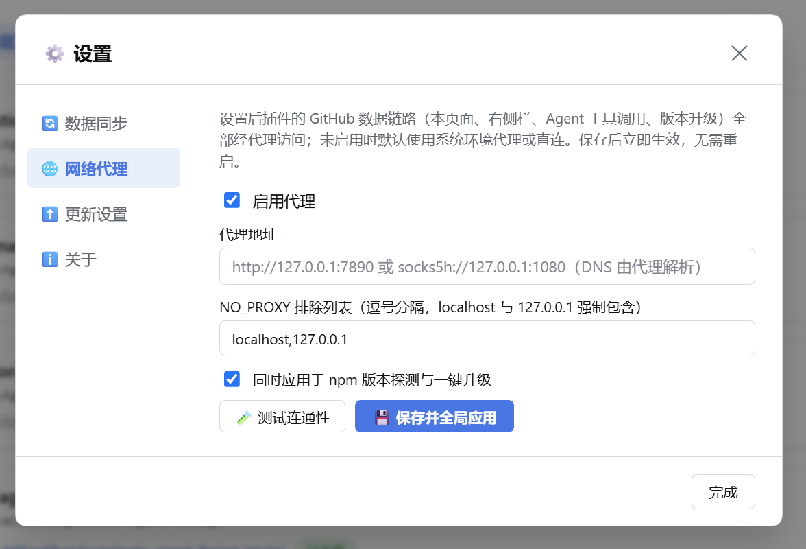

# DSH GitHub Flow (`dsh-github-flow`)

<p align="center">
  <a href="https://www.npmjs.com/package/dsh-github-flow"></a>
  <a href="https://www.npmjs.com/package/dsh-github-flow"></a>
  <a href="./LICENSE"></a>
  <a href="https://deepseek-harness.github.io/deepseek-harness/"></a>
  
</p>

<p align="center">
  <b>让 DeepSeek Harness Agent 拥有操作 GitHub 的原生手和脚，为人机协作打造沉浸式 GitHub 工作台。</b><br>
  原生复用宿主机 <code>gh</code> CLI 安全登录凭据，告别 Personal Access Token 泄露；深度打通本地 Git 工作区与云端仓库协作，兼具 <b>19 大领域 Agent 核心工具（106 个 action，覆盖 PR 审查/Issue 任务/Actions 工作流与构建缓存治理/免 clone 读文件/分支规则集策略排障/代码片段 Gist/标签与全局待办大盘/密钥与变量管理/智能体任务会话/社区 Discussions 讨论/Projects v2 看板/云端 Codespaces/运行时遥测与自愈健康度）</b>、<b>人类 Slash 快捷指令</b>、<b>Web UI 全景工作台</b> 与 <b>一键自动跨平台无缝升级</b>。
</p>

<p align="center">
  <b>简体中文</b> | <b><a href="./README.en.md">English</a></b>
</p>

---

## 🎯 为什么需要 `dsh-github-flow`？

在日常使用 AI Agent 辅助编程与工程研发时，开发者经常遭遇以下断层痛点：

| 研发协作场景 | 传统方式（痛点重重） | `dsh-github-flow`（原生体验） |
| :--- | :--- | :--- |
| **Agent 提 PR & 代码评审** | 用户必须手动在网页复制分支、点开 GitHub 网页点鼠标提交 PR，无法实现自主研发闭环。 | **Agent 原生提单与评审**：对 Agent 说“帮我把当前分支提个 PR”，Agent 调用 `github_pr` 自动完成提交与代码 diff 审查。 |
| **CI / Actions 构建报错修复** | 构建挂了后，开发者在网页翻几十页 Actions 日志，复制报错贴给 Agent 调试。 | **精准抓取报错**：对 Agent 说“看下 CI 为什么失败”，Agent 调 `github_run(log_failed)` 秒级定位失败步骤并自动修复代码。 |
| **安全性与鉴权维护** | 必须在插件配置文件里贴明文 GitHub Token（PAT），面临权限失控与密钥泄漏风险。 | **0 密钥泄露风险**：直接复用机器本地已认证的 `gh auth login` 凭据，使用系统安全 Keyring。 |
| **多任务切屏困扰** | 必须在 VS Code、浏览器 GitHub 标签页和 DSH 聊天窗之间反复切屏，上下文频繁丢失。 | **内置沉浸式全景工作台**：DSH 内部常驻 PR 门禁、CI 流水线、三维待办 Issue 矩阵，一目了然。 |
| **分支切换与本地改动感知** | 切分支需切回终端敲命令，且右侧栏无法感知本地代码暂存与提交改动，数据频频过时。 | **界面安全切分支 + 本地 Git 实时感知**：支持关键词过滤与未提交改动安全拦截；基于定向 `.git` 监听实现毫秒级自动对齐。 |
| **首屏加载与性能等待** | 每次打开全景驾驶舱全屏白屏卡死转圈 8~15 秒，等待所有网络与子进程请求返回。 | **SWR 0ms 瞬间秒开 + 云端定时同步**：打开立即呈现本地快照；支持 SWR 秒开、云端定时轮询（5~60m 息屏避让）与纯手动刷新三选一互斥模式。 |
| **插件维护与升级** | 插件更新全靠开发者去 npm 碰运气看版本号，命令复杂不敢升。 | **闲时静默探测 + Web 一键自动升级**：双源极速探测，自动适配 Mac/Windows 跨平台命令，界面点击即升。 |

---

## 🚀 安装指南

### 步骤 1：前置准备（若已安装可跳过）
确保你的机器上已安装 GitHub CLI (`gh`) 并已登录：
```bash
# Windows 安装
winget install --id GitHub.cli

# macOS 安装
brew install gh

# 登录认证（仅需执行一次）
gh auth login
```

### 步骤 2：安装插件到 DSH

在 DSH 终端根据你的使用环境执行对应命令：

```bash
# 场景 A：DSH 桌面版 (Desktop Profile)
dsh plugin --profile desktop add dsh-github-flow

# 场景 B：DSH Web / CLI 环境（--profile 为官方 CLI 必填参数，profile 名按实际环境填写）
dsh plugin --profile web add dsh-github-flow
```

> 💡 **提示（新版本发布后 24 小时内的安全锁定期说明）**：  
> DSH 内置包管理器默认启用了防投毒的供应链安全策略（`minimum-release-age = 24h`）。新版本发布后的 **24 小时内**，若执行不带版本号的裸名安装命令，底层会自动回退为发布满 24 小时的上一稳定版本。如需**立即尝鲜刚发布的新版本**，请在命令末尾显式追加 `@版本号`（替换为 npm 页面显示的最新版本）：
> ```bash
> dsh plugin --profile desktop add dsh-github-flow@<最新版本号>
> ```
> 版本发布满 24 小时后，执行原本的裸名命令即可默认解析安装最新版。

---

## 🤖 核心工具集 (Agent Tools)：给 Agent 装上 GitHub 的手和脚

本插件精选聚合为 **19 大领域核心工具（106 个 action）**，拒绝几十个无用微型工具撑爆 Agent 上下文，原生搭载 **Token 防溢出保护（默认 24KB 智能二分截断）**、**高密度 Markdown 原生渲染（列表输出压缩 70%+ Token）**、**OAuth Scope 缺失单行自愈引导** 与 **零参数 CWD 智能绑定**。

### 0. `github_task`：任务级原语（🆕 v0.7.0 新增）
> **典型对话指令**：
> - *"帮我审一下 PR #12，重点看安全问题"*
> - *"CI 为什么挂了？"*
> - *"下一个版本该发多少号？notes 写一下"*

上面 18 个领域工具是一张**动词表**（list / view / diff / checks / review…），而用户说的是**任务**。`github_task` 把三件最常反复走的事各封装成**一次调用**，返回**已裁剪、可直接执行**的结论包：

```text
summary（结论，≤1.5KB） + facts（结构化事实） + nextActions（可执行下一步） + cost（字符数 / gh 调用数 / 耗时）
```

* **`review_pr`**：一次拿齐 PR 元数据 + head SHA + 变动文件 diff（按 `budget_chars` 裁剪）+ CI 三态 + 仓库 `AGENTS.md` 审查规则 + 既有行级评论数。
  * `focus: 'security' | 'correctness' | 'perf' | 'style'` 只影响结论里的提示语，不改变取数。
  * **默认只读**；要写回行级评注必须 `write: true, confirm: true`（闸门会先返回确认载荷）。
* **`diagnose_ci`**：`run_id` 或 `pr_number` 二选一 → 定位失败 job/step → 按框架锚点萃取失败日志 → 汇总疑似相关文件。日志被截断时 `truncated.totalUnknown = true`，**不要据此判断「就这些失败」**。
* **`prepare_release`**：读最近 tag 以来的提交 → 按 Conventional Commits 归类 → 推导 SemVer（breaking→major / feat→minor / 其余→patch）→ 生成 notes 草稿 + 发版体检（工作区干净 / 同步远端 / CI 绿）。
  * **本原语不会打 tag、不会 push、不会创建 Release**：发版是人的决定，它只把「该发什么版本、notes 长什么样」准备好，并在 `nextActions` 里给出可直接执行的命令。

> **档位建议**：`toolsets: ['core']` 就是「3 个任务替代 15 个领域工具」（`github_task` + `github_repo` + `github_help`，schema 仅约 4,400 字符，比全量省 84%）。需要细粒度控制时再显式挂 `github_pr` / `github_run`——原语是快捷方式，不是唯一入口。

### 1. `github_pr`：PR 全生命周期管理与自动化代码审查
> **典型对话指令**：
> - *"帮我检查当前仓库有没有需要我审查的 PR？"*
> - *"帮我把当前特性分支创建一个 PR，标题叫 'feat: add dark mode'，附带简明改动说明"*
> - *"审查 PR #12 的代码差异并给出安全重构建议"*
> - *"检查 PR #8 的 CI 检查通过了吗？通过的话帮我 Squash 合并并删除源分支"*

* **支持操作 (`action`)**：
  * `list`：列出当前仓库开放的 PR（带作者、审查判定、CI 门禁状态，支持 `state` / `author` / `limit` 过滤）；
  * `view`：查看指定 PR 详情、描述与元数据；
  * `diff`：获取 PR 的完整代码差异（`stat_only` 仅看文件变更概览，防大 PR 溢出）；
  * `checks`：审查指定 PR 的 CI 门禁状态（通过/失败/跳过分类徽章、所属工作流与详情链接）；
  * `create`：一键自动创建 PR（支持 draft 草稿模式与 `--dry-run` 预演，支持 `attach_images` 上传本地附件）；
  * `edit`：🆕 编辑 PR 标题、描述与关联元数据，支持附加本地图片；
  * `comment`：🆕 向指定 PR 追加讨论评论与审查意见，支持附加本地图片；
  * `checkout`：🆕 把 PR 代码检出到本地分支，Agent 可直接在本地工作区跑测试验证改动（检出前校验工作区干净度；默认不重置已有同名分支，需要重置须显式传 `force: true` + `confirm: true`）；
  * `status`：🆕 查看当前分支关联 PR 的合并冲突状态（`CLEAN` / `CONFLICT`）；
  * `review`：提交代码审查意见（`APPROVE`, `REQUEST_CHANGES`, `COMMENT`）；
  * 🆕 **`review` + `comments`（行级评注写入，v0.7.0 新增）**：`gh pr review` 本身没有行级参数，本版本新增 `comments` 数组走 `POST /pulls/{n}/reviews`，一次提交多条挂在具体代码行上的评注。**不传 `comments` 时行为与旧版逐字节一致**（仍走 `gh pr review`），默认零写回。

    ```jsonc
    // github_pr(action:'review', pr_number:12, review_decision:'COMMENT',
    //            body:'整体说明', comments:[{ path:'src/a.ts', line:42, body:'这里要加锁' }])
    // 可选字段：side('LEFT'|'RIGHT'，默认 RIGHT)、start_line(多行评注)、commit_id(钉在指定 SHA)
    ```

    三条边界：① 单次最多 **50 条**；② `path`/`body` 必填、`line` 必须是正整数，校验不通过时**一次列出所有问题**而不是改一条试一次；③ 若某行不在 diff 的可评论侧（纯删除行等）导致 GitHub 返回 **422**，评注会**自动折叠进 review 正文**（带 `path:line` 前缀）重试一次并显式标记 `degraded`，内容不丢失。
  * 🆕 **严重度前缀 `[P0]` / `[P1]` / `[P2]`（v0.7.0 新增）**：`review` 的正文与每条行级评注在提交前会统一过一遍严重度归一化——**已有前缀原样保留，缺失才补 `[P2]`，永不降级 `[P0]`/`[P1]`**。目的是让一堆 P2 别把 P0 淹没；插件只补标签，不改写你的判断。
  * 🆕 **仓库审查规则注入（`AGENTS.md`，v0.7.0 新增）**：`view` 会读取工作区的 `AGENTS.md`（根目录 + 变更文件所在目录的就近文件，单文件 ≤8KB、合计 ≤16KB），把 `## Code Review Rules` 段（整文件没有该标题时退化为全文）作为 `reviewRules` 随结果返回，并在 Markdown 输出末尾渲染成「仓库审查规则」一节。**工作区没有 `AGENTS.md` 时输出不含该键**——「没有规则」与「规则为空」在结果里可区分。规则只经工具输出这一条通道进入上下文，不注入系统提示。
  * 🆕 **审阅锚点与截断可见性（v0.7.0 新增）**：`view` 现在返回 `headRefOid` / `baseRefOid` / `changedFiles`，Markdown 的分支行渲染为 `feat/x@a1b2c3d`（分支名会移动，SHA 不会）；`files` 清单被 gh 的 100 条上限截断时会显式说明「仅列出前 N / M 个」。
  * `merge`：自动执行合并（支持 `squash` / `merge` / `rebase`，可指定 `delete_branch`；需 `confirm: true` 二次确认）；
  * `ready`：🆕 Draft ↔ Ready 切换（附 `undo: true` 可转回 Draft，完整可逆）；
  * `revert`：🆕 创建反向提交（远端生成新 revert PR，需 `confirm: true`）；
  * `update_branch`：🆕 将基准分支最新提交同步进 PR 分支——「分支落后需更新」CI 门禁失败的自愈动作；
  * `view_images`：🆕 下载 PR 讨论截图（正文+评论，支持 `image_urls` 精准提取与触顶续传清单）；
  * `attach_images`（参数）：🆕 上传本地图片/附件至 PR（单批上限 50 个本地文件，与 `view_images` 形成对称闭环，需 gh ≥ 2.99）。

---

### 2. `github_issue`：Issue 任务流转与关联开发分支
> **典型对话指令**：
> - *"列出分配给我的所有待办 Issue"*
> - *"从 Issue #42 一键切出一个本地开发分支 'fix-login-error' 并开始修复"*
> - *"在 Issue #15 下追加评论，汇报我们刚才测试发现的边界情况并附上截图"*

* **支持操作 (`action`)**：
  * `list`：列出仓库 Issues（支持 `state` / `labels` / `assignees` 组合筛选，返回三维多标签）；
  * `view`：查看 Issue 完整讨论、正文与指派人；
  * `create`：新建 Issue 任务（支持 `attach_images` 附件上传）；
  * `comment`：向指定 Issue 追加讨论评论（支持 `attach_images` 上传错误截图）；
  * `edit`：编辑 Issue 标题、追加标签 (`add_labels`)、移除标签 (`remove_labels`)；
  * `close` / `reopen`：关闭或重新激活议题（`close` 需 `confirm: true`）；
  * `develop`：🆕 关联当前 Issue 一键创建本地 Git 开发分支；
  * `delete`：🆕 物理删除不可恢复（需 `confirm: true`，高危操作物理防误触）；
  * `transfer`：🆕 跨仓库迁移 Issue（原 URL 301 重定向，需 `confirm: true`）；
  * `pin` / `unpin`：🆕 仓库 Issue 置顶状态管理；
  * `lock` / `unlock`：🆕 锁定讨论区，支持 4 种官方合法理由（`off_topic` / `resolved` / `spam` / `too_heated`）；
  * `status`：🆕 检索指派给当前登录用户的待办议题全景面板；
  * `view_images`：🆕 下载 Issue 报障截图（正文+评论全量识别并转为本地图片块，Agent 直接"看"截图）；落地目录 `~/.dsh/data/dsh-github-flow/images/`（内容寻址去重），**超 15MB 时按 mtime 自动 LRU 淘汰至 10MB 低水位**，并保护当前批次已写入的文件；测试可用 `DSH_IMAGE_DIR` 重定向该目录；
  * `attach_images`（参数）：🆕 支持本地文件/截图直接作为附件随 Issue 发布（单批上限 50 个文件，需 gh ≥ 2.99）。

---

### 3. `github_run`：GitHub Actions 构建状态与智能排障修复
> **典型对话指令**：
> - *"检查 main 分支最近一次 CI 工作流跑挂了吗？"*
> - *"提取刚刚失败构建的日志，帮我分析是哪个测试用例挂了"*
> - *"重新运行最近一次失败的 CI 流水线"*

* **支持操作 (`action`)**：
  * `list`：列出指定分支或状态的 CI 构建记录；
  * `view`：查看工作流运行详情与各步骤状态；
  * `log_failed`：**🔥 排障神器**！自动精准定位失败的 Job 与 Step，仅提取报错那几十行核心日志，告别人工翻几万行日志；
    * 🆕 **按测试框架锚点萃取（v0.7.0 新增）**：不再把整段日志丢给模型。先按各框架的失败标记（pytest `FAILED`、node `AssertionError`、Go `panic:`、tsc `error TSxxxx`、`npm ERR!` 等）切出**失败块**（每块含起始行号与后续上下文，相邻标记自动合并），再按字符预算二次裁剪；块数超上限时显式写明「已省略 N 个失败块（共 M 个）」。**匹配不到已知锚点时回退尾部 200 行**并注明原因（失败结论在日志末尾，头部基本只有环境准备信息）。
    * 为此 `log_failed` 的输出预算放宽到 **2MB 字符 / 8MB 字节**——否则默认 24K 截断会发生在萃取**之前**，后面的失败根本进不了上下文。
  * `rerun`：一键重新运行失败的构建；
  * `cancel`：取消正在排队或执行的构建；
  * `trigger`：手动触发 `workflow_dispatch` 工作流，支持自定义入参；
  * `workflow_list`：🆕 列出仓库所有工作流（可传 `all: true` 显示被禁用的工作流）；
  * `workflow_view`：🆕 查看工作流 YAML 文件配置与累计运行次数；
  * `workflow_enable` / `workflow_disable`：🆕 动态启停指定工作流；
  * `download`：🆕 下载构建产物 Artifact（严格遵循 GHSA 路径隔离纪律落盘至插件管理目录）。

---

### 4. `github_repo`：仓库元数据、Fork 同步、免 Clone 读文件与跨仓检索
> **典型对话指令**：
> - *"帮我把当前 Fork 的仓库主干同步拉平"*
> - *"在当前仓库检索哪里用到了 'useAuthToken' 这个函数"*
> - *"免 clone 查看一下远程仓库 'src/utils.ts' 的文件内容"*
> - *"读取当前仓库的 README 看看架构设计，并把里面的流程图下载下来分析"*

* **支持操作 (`action`)**：
  * `view`：查看仓库基本信息、默认分支、Star/Fork 数、License 与 Topics 标签；
  * `readme`：🆕 读取当前仓库 README 原文并自动提取内部所有图片链接，可传 `image_urls` 精准下载指定插图；
  * `sync`：一键自动同步 Fork 仓库的主干分支（支持 `--force` 硬重置解决分叉冲突）；
  * `read_file`：🆕 免 clone 直接读取任意分支/Tag/Commit 的指定文件内容（`gh ≥ 2.95` 直读，旧版自动降级 REST API 链路）；
  * `read_dir`：🆕 免 clone 读取任意分支目录树清单（文件类型、名称与人性化体积）；
  * `search_code`：跨仓库代码检索（需包含搜索关键词，支持高级限定符）；
  * `search_repos`：跨全站仓库关键词检索；
  * `search_issues` / `search_prs`：全局 Issue/PR 关键词复合检索；
  * `search_commits`：全局提交记录关键词检索。

---

### 5. `github_release`：版本发布交付与构建资产管理
> **典型对话指令**：
> - *"查看当前仓库最新的 Release 版本与更新日志"*
> - *"基于最近的提交记录，自动生成 v0.4.0 的发版说明并创建一个草稿 Release"*
> - *"把本地构建产物 'dsh-github-flow-0.4.0.tgz' 上传到最新 Release 中"*

* **支持操作 (`action`)**：
  * `list`：查看历史 Release 版本清单；
  * `view`：查看指定 Tag 的发布说明与附属构建资产清单；
  * `create`：创建新版本 Release（支持 `generate_notes` 自动从 commit 生成说明，支持 `draft` / `prerelease` / 预置资产上传）；
  * `upload`：向已有 Release 追加上传本地资产（支持 `clobber: true` 覆盖上传，需 `confirm: true`）；
  * `download`：下载 Release 产物文件（支持 `pattern` glob 模式过滤）；
  * `delete`：删除 Release（支持 `cleanup_tag: true` 连同 Git Tag 一并清理，需 `confirm: true`）。

---

### 6. `github_secret`：CI/CD 密钥 (Secret) 与变量 (Variable) 管理
> **典型对话指令**：
> - *"列出当前仓库配置了哪些 Actions Secrets"*
> - *"帮我设置一个名为主机发布的 secret 'DEPLOY_KEY'"*
> - *"查看明文变量 'NODE_ENV' 的当前值"*

* **支持操作 (`action`)**：
  * `list`：列出仓库配置的密钥或变量名称清单（密文永不回显，变量可读）；
  * `set`：设置或更新密钥（**安全纪律：密文经子进程标准输入 stdin 安全写入，全程不出现在命令行参数与进程列表中**）或设置明文变量；
  * `get`：🆕 获取明文变量的值（仅 `kind: 'variable'` 可用；Secret 受 GitHub 物理加密保护不可读取）；
  * `delete`：删除密钥或变量（删除 Secret 需 `confirm: true`）。

---

### 7. `github_skill`：Agent Skills 生态发现与本地安装 🧪 Preview

> 🧪 **Preview 依赖**：底层是 `gh skill`，该命令当前为 public preview（`subject to change without notice`），命令面可能随 gh 升级变更。

> **典型对话指令**：
> - *"在 GitHub 开源社区检索关于 'markdown' 的 Agent Skills"*
> - *"预览并安装 'github/awesome-copilot' 仓库里的代码审查 Skill 到当前项目"*

* **支持操作 (`action`)**：
  * `search`：跨 GitHub 开源仓库检索符合规范的 Agent Skills；
  * `preview`：免安装直接在线预览指定 Skill 的 `SKILL.md` 规则与行为指令；
  * `install`：一键安装指定 Skill 至本地环境（支持 `scope: 'project'` 或 `'user'`，需 `confirm: true`）；
  * `list`：查看当前环境已安装的 Skills 清单；
  * `publish`：🆕 **Agent 技能自检与发布闭环**：默认 `--dry-run` 模式进行 agentskills.io 规范体检，支持 `--fix` 自动剔除安装残留元数据，正式发版强制要求指定版本 `tag` 并附带 `confirm: true` 自动创建 GitHub Release；
  * `update`：🆕 **批量检查与同步更新**：默认 `--dry-run` 只读比对本地与远端 SHA 差异，支持 `--all` 批量同步更新已安装技能。

---

### 8. `github_help`：全景映射总表、官方语法速查与故障自愈
> **典型对话指令**：
> - *"我不确定用哪个工具操作 Discussions，帮我查查映射表"*
> - *"查询一下 GitHub 搜索日期的过滤语法是什么"*
> - *"调用 gh 命令报错 'authentication failed'，该怎么排查？"*

* **支持操作 (`topic` / `gh_command`)**：
  * `overview`：输出全景工具箱导航与核心职责速查（19 大工具矩阵全景）；
  * `mapping`：**官方命令映射总表**，精准指示任意 `gh <command>` 对应哪个插件工具，以及未覆盖域对应的 GitHub REST/GraphQL 端点；
  * `search_syntax`：日期区间、状态筛选与高级布尔搜索语法指南；
  * `troubleshooting`：常见错误自愈配方（认证失效、网络超时、SOCKS5 代理配置、权限不足等）；
  * 领域速查：`pr` / `issue` / `run` / `repo` / `release` / `secret` / `skill` / `label` / `ruleset` / `cache` / `gist` / `status` / `agent_task` / `discussion` / `project` / `codespace` 专项高阶用法；
  * `gh_command`：直接透传查询官方原生手册（如 `gh_command: 'ruleset'`）。

---

### 9. `github_api`：原生 GitHub REST / GraphQL 逃生门
> **典型对话指令**：
> - *"调用 GitHub API 获取当前登录用户的 Profile 信息"*
> - *"调用 GraphQL 查询指定仓库的 Discussions 列表"*

* **支持功能**：直接通过宿主机已认证的 GitHub CLI 环境调用任意 REST 或 GraphQL 端点，支持 `--jq` 结果精简、自动分页 (`paginate: true`)、请求参数字面量直传与 `raw: true` 原始响应流（如免 Base64 读取文本文件）。

---

### 10. `github_label`：标签体系管理与跨仓库一键克隆
> **典型对话指令**：
> - *"查看当前仓库有哪些标签，按名称排序"*
> - *"创建一个名为 'priority/p0' 的严重缺陷标签，颜色设为 #d73a4a"*
> - *"把 'cli/cli' 仓库的标准标签体系一键克隆到当前新仓库"*
> - *"删除弃用的 'invalid' 标签"*

* **支持操作 (`action`)**：
  * `list`：列出仓库标签（支持 `search` 模糊检索、`sort: 'created' | 'name'` 与 `order: 'asc' | 'desc'` 排序）；
  * `create`：新建标签（十六进制色值校验与去前导 `#`，支持 `force: true` 覆盖已存在标签）；
  * `edit`：编辑标签颜色、描述，或通过 `new_name` 重命名；
  * `delete`：安全删除标签（影响所有已关联 Issue/PR，必须 `confirm: true` 二次确认，注入 `--yes` 防挂起）；
  * `clone`：🆕 **跨仓库一键克隆**：从源仓库 (`source_repo`) 将全量标签体系同步至当前目标仓库，新仓库初始化刚需（支持 `force: true` 覆盖冲突标签）。

---

### 11. `github_ruleset`：分支合并保护规则与策略排障
> **典型对话指令**：
> - *"为什么当前分支的 PR 无法合并？帮我检查适用的保护规则"*
> - *"检查 master 分支是否配置了必须通过 CI 或至少 2 人审批的规则约束"*
> - *"查看当前仓库的所有规则集列表"*

* **支持操作 (`action`)**：
  * `check`：**🔥 PR 合并策略排障核心**！查看指定分支匹配到的全部硬性策略规则（如强制 CI 门禁、审批人数、禁止 Force Push 等），与 `github_pr(action: 'checks')` 形成“CI 运行视角 + 规则策略视角”的权威排障合力；
  * `list`：查看规则集列表（支持 `--org` 组织级查询与 `--no-parents` 排除继承）；
  * `view`：查看具体规则集详细约束与目标分支（强制校验 `ruleset_id` 防交互式挂起）。

---

### 12. `github_cache`：Actions 构建缓存盘点与安全清理
> **典型对话指令**：
> - *"盘点一下当前仓库的 Actions 缓存占用了多少空间？"*
> - *"按占用体积降序排列所有构建缓存"*
> - *"清空当前仓库所有过期的 Actions 缓存"*

* **支持操作 (`action`)**：
  * `list`：盘点仓库 Actions 缓存占用，自动换算人性化体积（KB/MB/GB），支持 Key 前缀过滤、Git Ref 过滤与按大小/访问时间排序；
  * `delete`：三态精准清理（按数字 `cache_id` 删除、按 `key` 删除、或通过 `all: true` 全量清空全部缓存；**三种方式均强制要求 `confirm: true`**，全量清空另注入 `--succeed-on-no-caches` 保证幂等执行）。

---

### 13. `github_gist`：代码片段与排障留痕轻量治理
> **典型对话指令**：
> - *"把刚才的排错日志创建为一个 Secret Gist 并把链接发给我"*
> - *"查看我账号下的 Gist 代码片段列表"*
> - *"检视 Gist '5b0e0062eb8e9654adad7bb1d81cc75f' 的代码正文"*

* **支持操作 (`action`)**：
  * `list`：列出当前用户账号下的 Gist 清单（TSV 结构化解析，支持 `public` / `secret` / `filter` 过滤）；
  * `view`：查看指定 Gist 的原始代码正文（支持 `filename` 单文件筛选，强制校验 `gist_id` 防挂起）；
  * `create`：新建 Gist（支持 `content` 经 stdin 管道直接传入，或传 `files` 本地文件列表，默认安全创建 Secret Gist 并显式附带 **Unlisted 弱保密安全警示**）；
  * `edit`：编辑 Gist 描述或修改文件；
  * `delete`：物理删除 Gist 代码片段（不可逆，强制要求 `confirm: true` 与 `--yes`）。

---

### 14. `github_status`：跨仓库待办与运行时健康度大盘
> **典型对话指令**：
> - *"帮我看看今天在 GitHub 上有哪些需要我处理的事情？"*
> - *"查看当前账号在所有订阅仓库中的最新动态与 @提及"*
> - *"查看当前工具链的运行健康度与 API 降级率报表"*

* **支持操作 (`action`)**：
  * `view`：**账号维度跨仓一站式聚合大盘**（默认），汇总展示「指派给我的 Issue」、「指派给我的 PR」、「等待我评审的 PR (Review Requests)」、「提及我的消息 (Mentions)」以及「订阅仓库近期动态 (Repository Activity)」，无需绑定单仓即可一览全局工作台；支持 `-o` 组织过滤与 `-e` 排除噪音仓库；
  * `health`：🆕 **工具链运行时健康度与降级率审计报表**：基于 Cordis `tools/result` 事件切面，实时审计全插件 19 大核心工具的调用总量、成功率、综合健康分（0~100 分）、API 降级率与智能自愈建议。

---

### 15. `github_agent_task`：云端编码智能体任务会话治理 🧪 Preview

> 🧪 **Preview 依赖**：底层是 `gh agent-task`，该命令当前为 public preview（`subject to change without notice`），命令面可能随 gh 升级变更。

> **典型对话指令**：
> - *"查阅我名下所有的 GitHub Copilot 智能体任务会话列表"*
> - *"检视任务 'e2fa49d2' 的执行状态，并抓取详细会话日志"*
> - *"向云端 Agent 发起新任务：'重构网络通信模块以支持自动重试'，基于 develop 分支"*

* **支持操作 (`action`)**：
  * `list`：列出当前用户关联的智能体任务（支持 `-L/--limit`；`gh agent-task list` 不支持 `-R/--repo`，该参数对本动作无效）；
  * `view`：查看任务详情与会话执行日志（支持 `--log`，强制校验 `task_id` 防交互挂起）；
  * `create`：向云端 Agent 派发新编码/重构任务（支持 `-b/--base` 指定基准分支，`-a/--custom-agent` 指定仓库智能体定义）。

---

### 16. `github_discussion`：团队技术研讨与开源社区 RFC 闭环 🧪 Preview

> 🧪 **Preview 依赖**：底层是 `gh discussion`，该命令当前为 public preview（`subject to change without notice`），命令面可能随 gh 升级变更。

> **典型对话指令**：
> - *"查看当前仓库分类为 'Ideas' 的开放讨论列表"*
> - *"查看讨论 #101 的正文内容与回复楼层"*
> - *"在 'RFC' 分类下发起新讨论：'关于接入自动化遥测系统的提案'"*
> - *"向讨论 #101 发表回复评论"*

* **支持操作 (`action`)**：
  * `list`：查阅 Discussions 列表（支持 `-c/--category`、`-s/--state`、`--labels` 与 `-S/--search` 过滤）；
  * `view`：查看讨论正文与多楼层评论（支持 `--comments`，强制校验 `discussion_number`）；
  * `create`：发起新讨论（`category`、`title`、`body` 三项必填，缺少给出友好指引）；
  * `edit`：编辑现有讨论的标题或正文；
  * `comment`：向指定讨论追加发表评论回复。

---

### 17. `github_project`：Projects v2 项目看板与任务规划
> **典型对话指令**：
> - *"列出我名下的所有 Projects v2 项目看板"*
> - *"查看项目 #1 看板中的所有任务条目，筛选 open 状态"*
> - *"将 Issue 'https://github.com/owner/repo/issues/10' 添加到项目 #1 看板中"*
> - *"在项目 #1 看板中创建一个草稿条目：'完成单元测试覆盖'"*

* **支持操作 (`action`)**：
  * `list`：查看用户或组织的项目列表（默认 `owner: '@me'`，底层自动适配 `--format json` 勘误）；
  * `view`：查看项目元数据、可见性、描述与 README；
  * `item-list`：查看看板条目（支持 Projects 过滤查询语法 `--query`，如 `is:open assignee:@me`）；
  * `item-add`：关联已有 Issue/PR URL 进看板；
  * `item-create`：在项目中创建草稿条目（Draft Issue）；
  * `item-delete`：从看板移除条目（强制 `confirm: true` 拦截）；
  * 🔑 **权限自愈**：检测到缺少 `read:project` 权限时自动输出单行自愈授权卡片（`gh auth refresh -s read:project`）。

---

### 18. `github_codespace`：云端远程开发环境管控 (MVP)
> **典型对话指令**：
> - *"查看我当前有哪些运行中的 Codespace 云端开发机？"*
> - *"检视实例 'fuzzy-spoon-69vj' 的机器规格与空闲停机策略"*
> - *"把开发机 'fuzzy-spoon-69vj' 关机停止运行，防止扣除核时费用"*
> - *"销毁已经用完的临时 Codespace 实例"*

* **支持操作 (`action`)**：
  * `list`：列出当前用户或组织名下的 Codespace 环境（展示状态、机器规格与上次使用时间）；
  * `view`：检视环境详细配置与 DevContainer 路径（强制校验 `codespace` 名称防交互挂起）；
  * `stop`：发送停机指令，立即停止计算资源计费；
  * `delete`：安全销毁实例（物理销毁不可逆，强制 `confirm: true` 拦截，底层传 `-f` 保证无交互幂等删除）；
  * 🔑 **权限自愈**：检测到缺少 `codespace` 权限时自动输出单行自愈授权卡片（`gh auth refresh -h github.com -s codespace`）。

---

## 🖥️ Web UI 全景驾驶舱与右侧栏工作台

不仅仅是给 Agent 调用的工具，`dsh-github-flow` 为人类开发者提供了无缝融合的图形化控制面板：

### 1. 全景驾驶舱 (Main Dashboard)
点击 DSH 左侧导航栏的 **Octocat 徽标** 即可瞬间打开全屏驾驶舱：
* **📦 实时数据新鲜度胶囊**：标题栏旁直观展示数据状态（`[📦 本地快照 (21分钟前)]` ➔ `[⏳ 后台同步中...]` ➔ `[✅ 已是最新 (15:30)]` ➔ `[⚠️ 网络连接失败，当前展示离线历史数据]`）；
* **账号全景概览**：实时透视名下所有 GitHub 仓库、默认分支与 Star 状态；
* **本地工作区联动矩阵**：自动探测本机所有打开的项目，显示当前工作区与远程 GitHub 仓库的关联状态；
* **三维待办 Issue 矩阵**：智能划分「📥 用户提单（反馈到我名下仓库）」、「🎯 指派待办（分配给我）」与「✍️ 我发起的」，支持一键药丸过滤；
* **🔀 PR 在线审阅工作台**：点击任意 PR，无需离开 DSH 即可查看作者与分支流向、CI/审查状态、Markdown 描述、评论时间线，以及变动文件列表与高保真 Unified Diff 对比（按文件内存切片，切换文件 0ms）；
* **📝 Issue 在线查看弹窗**：点击任意 Issue 直接查看完整讨论——正文与评论均为 Markdown 渲染、长内容自动折叠、被 GitHub 折叠的垃圾评论显式标注、标签色块/指派人/里程碑/子议题进度/关联 PR 一目了然，评论时间线按时间顺序完整呈现；
* **升级提示横幅**：检测到新版本时在顶部优雅滑出，提供一键自动升级与更新日志直达。

<p align="center">
  
</p>

### 2. 会话右侧栏工作区面板 (Session Workspace Panel)
位于每个对话工作区的右侧抽屉栏，深度联动本地 Git 状态与远程 GitHub 仓库：
* **当前仓库上下文绑定**：自动锁定当前会话的物理 Git 仓库，展示远程关联与认证账号；
* **⎇ 分支查看与无损切换 (Branch Selector)**：
  * 在当前仓库卡片中直观展示当前分支与下拉选择器；
  * 采用标准 **Git 官方菱形分支矢量组件（`#1296db` SVG）**，完全杜绝植物/草符号；
  * 随 overview 接口预取分支数据，点击 **0ms 瞬间展开**下拉菜单，支持输入关键词即时过滤本地与远程分支；
  * **未提交变更防护（Dirty File Guard）**：切换前后端严格执行工作区干净度校验，存在未暂存或未提交代码时强阻断切换，彻底防止代码被破坏性覆盖；
* **数据新鲜度胶囊对齐**：标题旁紧凑呈现 `[📦 本地快照 (2分钟前)]` 与 `[🔄 刷新]` 按钮，与主页规则 100% 保持一致，首屏 0ms 瞬间直出；
* **快捷操作网格**：一键在浏览器打开仓库、直达 Issues/PRs、一键创建 PR；
* **五大 Tab 布局响应式互斥切换**：快捷操作下方采用紧凑 Tab 架构，内容区互斥展示、大幅降低纵向滚动需求：
  * **Git 记录 (`Git`)**（默认首屏）：
    * 分支与同步状态：展示当前分支（如 `master`）与远程同步快照（`✓ 与远程同步` 或 `↑N 待 push` / `↓N 待 pull`）；
    * 三段式提交视图：待推送提交（本地领先）、待拉取提交（远程领先）及最近提交列表；
    * 默认展示 15 条，支持**向下滑动触底自动分页加载**（伴随 `15 / 74` 实时进度提示与点击后备）；
    * 右上角锚定最新发布 Release 徽章（`🏷️ v0.4.0`），悬停查看发布时间与预发布标示，点击直达；
    * **提交详情模态弹窗**：点击任意提交记录行，在右侧栏内局部居中弹出，内置上下滑动区域，完整展示 40 位 SHA、提交者姓名邮箱、日期、多行详细正文说明与文件变更统计（`--stat`），纯本地 0ms 秒开，支持按 `Esc` 或点击遮罩随时关闭；
  * **未提交清单 (`📁 未提交 (N)`)**：展示工作区未提交的文件清单，状态码色彩区分（`??` 新增、`M` 修改、`D` 删除、`R` 重命名）与变更总数；
  * **拉取请求 (`🔀 PR (N)`)**：展示**全部** PR（含已合并/已关闭，默认「全部」），顶部状态胶囊 `全部 / 🟢 Open / 🟣 Merged / ⚪ Closed` 一键筛选并显示各档计数；带三态 CI 门禁（`✅ CI 通过` / `❌ CI 失败` / `⏳ CI 运行中`）、冲突检测、审核判定（`✔ 已批准` / `✋ 需修改` / `👀 待审查`）、Draft 草稿标示与人性化相对时间；**点击卡片在线唤起 PR 审阅工作台（描述 / 评论 / 文件 Diff）**，右侧 `GitHub ↗` 保留浏览器直达；
  * **仓库议题 (`📋 Issues (N)`)**：展示**全部** Issue（含已关闭，默认「全部」），顶部状态胶囊 `全部 / 🟢 Open / ⚪ Closed` 一键筛选并显示各档计数；支持指派者、标签与多维状态药丸；**点击卡片在线查看 Issue 详情（Markdown 正文 / 评论时间线 / 标签与里程碑，Esc 关闭）**，右侧 `GitHub ↗` 保留浏览器直达；
  * **构建流水线 (`⚡ Actions (N)`)**：实时关注工作流 CI 状态，展示触发方式（`push`/`定时`/`手动`/`PR`）与相对时间；**点击卡片在线查看本次运行的 job / step 树与失败步骤**，失败时可按需提取日志锚点片段（不用切浏览器），右侧 `GitHub ↗` 保留完整日志直达，并给出可直接交给 Agent 的 `diagnose_ci` 诊断指引（嵌入 run_id）；
* **⚙️ 完整设置入口**：右侧栏提供设置按钮，与主页复用同一设置弹窗（数据同步 / 网络代理 / 更新设置 / 关于 四分区完整可用），无需切回主页调整。

<p align="center">
  
</p>

### 3. 使用指南大窗口 (Help & Playbook)
点击驾驶舱右上角 **`[📖 使用指南]`**（或右侧栏的 ❓ 按钮）打开 920px 宽屏沉浸式手册，按 Esc 或点遮罩即可关闭。共 5 个分类：
* **🚀 3分钟极速上手**：登录确认 → 绑定仓库 → 向 Agent 下指令的三步闭环，附能力总览（19 工具 / 106 业务动作 / 2 套工作台）；
* **🤖 Agent 提示词实战**：7 大高频场景（建 PR、CI 排障、待办盘点、Diff 审查、看图定位、批量标签治理、RFC 研讨），每条配「📋 一键复制 Prompt」；
* **🖥️ 两大界面操作图解**：主面板 4 标签与右侧栏 5 Tab 的逐项说明，以及两个弹窗的通用操作习惯；
* **🧰 19 大工具速查**：按「日常研发 / 交付配置 / 生态协作 / 兜底元能力」四组列出全部工具与动作，附 `/gh` 指令速查；
* **🔑 常见自愈排错**：登录、权限 Scope、24h 安全保护期、代理抖动、列表为空、为何需重启 DSH 共 6 条。

> 同一套知识也通过 `github_help` 工具提供给 Agent——两侧口径由 phase33 测试强制对账，代码演进而文档没跟上会直接测试失败。

### 4. 设置中心 (Settings Modal)
点击全景驾驶舱右上角 **`[⚙️ 设置]`**（或右侧栏的 ⚙️ 按钮）打开分区式设置弹窗，左侧分区导航、右侧内容独立滚动（窄屏自动折叠为横向页签）：

**🔄 数据同步分区**——调优数据拉取节奏与感知灵敏度：
* **数据刷新策略（三选一互斥模型）**：
  * **⚡ 秒开展示旧数据 (SWR, 默认)**：打开驾驶舱立即展示上次本地缓存（0ms秒开），并在首屏后台静默拉新一次——无论缓存多旧，打开即可自愈为最新；
  * **☁️ 云端数据定时自动同步 (SWR + 定时轮询)**：首屏秒开旧数据并立即拉新，拉取结算后开始计时；循环静默更新 PR、Issue 与 Actions（支持 **5/10/30/60 分钟** 多档可选，内置窗口息屏自动避让，防止后台耗尽 API 配额）；
  * **📋 仅在手动点击时拉取 (Manual Only)**：打开只浏览本地缓存，绝不自动触发后台 gh 进程，最省电、最省资源；想更新时点击「🔄 刷新」即可。
* **高级自动化与状态感知**：
  * **📁 本地 Git 改动实时感知 (仅右侧栏生效，默认开启)**：定向监听当前仓库的 `.git/HEAD` 与 `.git/index` 元数据，代码修改、暂存与分支切换在 800ms 防抖后毫秒级自动对齐右侧栏，零外部网络流量消耗；全景首页保持轻量不开启。
* **本地缓存可视化管理**：透明查看本地快照体积与保存时间戳，支持一键 `[🗑️ 清空缓存]` 重置。

**🌐 网络代理分区**——让插件全部外联流量走你的代理：
* **全局生效范围**：设置后驾驶舱、右侧栏面板、19 大 Agent 工具调用与一键升级链路全部经代理访问；未启用时默认使用系统环境代理（`HTTPS_PROXY` 等）或直连；
* **协议支持**：`http://` / `https://` / `socks5://` / `socks5h://`（gh 与 npm 链路原生支持 SOCKS5；`socks5h` 会把域名解析也交给代理端，抗 DNS 污染更强；npm 版本探测走 Node fetch 暂不支持 SOCKS，将保持直连并在界面如实标注）；
* **`[🧪 测试连通性]`**：一键探测经当前代理访问 GitHub API 的延迟；
* **保存即生效**：写入 `~/.dsh/data/dsh-github-flow/proxy.json` 持久化（DSH 重启自动恢复），无需重启、不重载插件；
* **生效可视化**：代理启用时驾驶舱标题栏显示 `🌐 代理` 徽章，悬停查看当前代理地址；
* **NO_PROXY 排除列表**：`localhost` 与 `127.0.0.1` 强制包含，本机 Web API 回环请求永不被代理劫持。

**⬆️ 更新设置分区**——选择新版本检测所用的 npm 源：
* **三态单选**：🌍 npm 官方源（默认，版本全球首发最及时）/ 🇨🇳 国内镜像 npmmirror（国内访问快，同步存在分钟级延迟）/ ⛔ 不检查更新（仅关闭自动提示横幅，`/gh upgrade` 与一键升级仍可用）；
* **单源严格不互备**：显式选择的源不会被静默替换——选官方就只查官方，探测失败如实提示而非假装正常；
* **检测与升级流量遵循全局代理设置**（与网络代理分区联动，socks5 边界在界面如实标注）；
* **一键升级的安装源跟随选择**：选了镜像源，一键升级也走镜像安装；
* **保存即验证**：切换源后立即用新源真实探测一次并回显最新版本号。

**ℹ️ 关于分区**——插件身份与项目信息：
* 当前运行版本、项目简介、GitHub 仓库地址、npm 包页面与 MIT 开源协议；
* 求 Star 卡片——如果插件对你的研发有帮助，欢迎到仓库点个 Star 支持持续迭代。

> 🏷️ **插件身份标识**：全景驾驶舱与右侧栏的标题旁均带有「插件」小徽标，明确标识界面由第三方插件 `dsh-github-flow` 提供（非 DSH / GitHub 官方功能）。点击徽标即可打开「关于」页面查看项目信息。

| 🔄 数据同步分区 | 🌐 网络代理分区 |
| :---: | :---: |
|  |  |

---

## ⚡ 智能升级与版本检查机制

再也不用担心错过新功能！`dsh-github-flow` 内置了工业级的版本管理机制：

1. **业务优先，检查与 gh 链路完全并行**：
   - 版本检查与 gh 环境探测（安装/登录/业务数据）**零依赖并行发起**（挂载即触发，仅 300ms 微延迟避让首屏渲染），不串行等待 gh 概览返回，gh 环境异常也绝不影响升级提示；
   - 服务端 `inFlightPromise` 合流 + 24 小时缓存，多面板同时挂载零请求风暴。
2. **更新源自主可选**（详见设置中心「⬆️ 更新设置」分区）：
   - 默认走 **npm 官方源**（版本全球首发最及时），或切换 **国内镜像 npmmirror**（同步存在分钟级延迟）；
   - 可完全关闭自动检查（仅关提示不关能力，`/gh upgrade` 与一键升级仍可用）。
3. **跨平台一键自动升级**：
   - **界面直升**：在全景驾驶舱或右侧栏点击 **`[⚡ 一键自动升级]`**，插件在后台安全执行拉取；
   - **智能适配**：自动识别 macOS、Windows 与桌面版 Profile，Mac 环境下自动补全 Homebrew 环境变量；
   - **安装源跟随设置**：一键升级的 registry 跟随「更新设置」所选源，与版本检测保持一致；
   - **源码保护防线**：检测到本地 Git 源码软链接模式（`link:`）时自动阻止覆盖，防止破坏开发工作区；
   - **成功自愈提示**：升级成功后明确提醒重启 DSH 服务以激活后端新工具，也可点击按钮立即刷新页面预览新界面。

---

## ⏱️ SWR 秒开缓存与数据拉取节奏控制

为什么以前打开全景驾驶舱需要等待好几秒？因为全景数据要并发调用十余次 `gh` 进程扫描多个仓库与工作区。本插件引入了 **Stale-While-Revalidate (SWR)** 缓存体系，并把控制权完全交还给用户：

```text
首次挂载 (0ms) ──────────> 恢复本地持久化快照，瞬间完整上屏
                                │
                                ├── SWR 秒开模式: 延迟 300ms 后台静默拉新一次，平滑对齐最新数据
                                ├── 云端定时自动同步: 首屏拉新结算后开启周期计时器 (5/10/30/60m 息屏避让)
                                └── 纯手动模式: 仅浏览本地快照，点击「🔄 刷新」才发起拉取
```

### 三种刷新策略对比与选用建议：

| 刷新模式 | 运行机制 | 适用人群与场景 |
| :--- | :--- | :--- |
| **⚡ 秒开模式 (SWR, 默认)** | 打开驾驶舱 **0ms 立即呈现** 上次保存的本地离线快照，并在首屏后台静默更新——无论快照多旧，打开即自愈为最新。 | **强烈推荐所有开发者**。消灭白屏转圈，体验最顺畅丝滑。 |
| **☁️ 云端定时自动同步 (SWR + 定时轮询)** | 首屏秒开旧数据并立即拉新，拉取结算后开始周期倒计时（5/10/30/60分钟）；内置息屏避让，后台标签页不耗配额。 | **需要持续关注多仓库动态、CI 状态与团队 Issue 流转的深度用户**。 |
| **📋 仅手动刷新 (Manual Only)** | 仅浏览本地已有数据，绝对不自动发起任何后台 `gh` 网络拉取。 | **笔记本电池供电、低配设备或弱网环境**。极致节能，杜绝无谓后台开销。 |

* **离线韧性保障 (Fail-Safe)**：即使完全断网或后台请求超时，**界面依然完整保留本地快照供您浏览与检索，配合醒目的网络异常横幅与 Toast 提示，绝不静默欺骗，更绝不白屏崩溃！**

---

## 💬 人类 Slash 指令速查

在 DSH 任意聊天窗口输入：

* `/gh status`：一键诊断当前 GitHub CLI 账号认证状态、作用域、当前工作区关联仓库、插件版本与**工具链运行时可观测性（健康分与 API 降级率）**；
* `/gh upgrade`：主动检测 npm 最新版本，自适应输出当前操作系统（macOS / Windows / Linux）的最佳升级指引；
* `/gh help`：查看帮助说明与 Agent 典型对话范例。

---

## ⚙️ 插件配置项参考 (`cordis.yml`)

插件支持通过 DSH 配置文件进行精细化微调：

```yaml
- id: github-flow
  name: dsh-github-flow
  config:
    ghPath: 'gh'              # GitHub CLI 可执行文件路径（默认 'gh'，从系统 PATH 查找）
    defaultTimeoutMs: 30000   # 命令执行超时时间（毫秒，默认 30 秒）
    maxOutputChars: 24000     # 单次命令安全返回字符数上限（Token 防溢出保护）
    maxOutputBytes: 96000     # 单次命令 UTF-8 字节数硬上限，默认 maxOutputChars × 4
    defaultListLimit: 20      # 列表类查询默认返回条数（pr/issue/run/release/skill 通用）
    cacheTtlMs: 15000         # 单仓库概览缓存时长（毫秒，默认 15 秒）
    checkUpdate: true         # 是否开启新版本自动检查提示（默认开启；false 时熔断自动探测，显式升级不受限）
    agentEnvInjection: true   # 向 gh 注入 AI_AGENT=dsh 识别信号（gh ≥2.99 自动适配 Agent 输出；false 恢复 gh 原生行为）
    updateCheckIntervalMs: 86400000 # 检查更新间隔（毫秒，默认 24 小时）
    registryUrl: ''           # 自定义私有 npm 镜像地址（留空走「更新设置」所选源，界面设置优先）
    proxyUrl: ''              # 代理地址预置默认值（如 'http://127.0.0.1:7890'；仅未在驾驶舱设置过时生效，界面设置优先）
    toolsets: ['core']        # 工具档位：留空/full = 19 个全量；core=3 / ci=7 / maintain=8；也可混写工具名如 github_pr
    read_only: true           # 只读档位：写 action 在注册期就从工具 schema 中剔除，github_api 整体不注册
```

> `toolsets` 决定的不是「运行时允许什么」，而是**注册给模型的工具面本身**：不填 = 19 个工具全量常驻（约 27,000 字符 schema），`core` 只有 3 个（约 4,400 字符，**省 84%**）。填错档位名会 `console.warn` 打出可用档位清单，不会静默把工具清空。
> `read_only` 是硬语义，两层生效：① 注册期把写 action 从参数 `enum` 里剪掉（模型在 schema 层看不到）；② **执行入口再拦一次**——本插件用的是手写 descriptor，宿主不会替我们做参数校验，所以被剪掉的 action 即使带着 `confirm: true` 也会在到达 `gh` 之前被拒绝并抛出「只读模式」。`github_api` 因端点与 method 均可任意而无法降级，只读模式下整体不注册。
> 边界说明：`github_help` 的帮助文本是一份**文档**，只读模式下仍会列出全部能力（含写操作的用法），它不构成可执行的契约——真正拦住写操作的是上面那两层。


> 配置由 Schemastery Schema 校验：类型写错（例如把 `maxOutputChars: '24000'` 写成字符串）会**直接报错**，不再静默回落到默认值。
> `maxOutputChars` / `defaultTimeoutMs` / `defaultListLimit` 是**热更新字段**——改这几项时 loader 只把新值热提交进运行中的实例，不触发插件整体重载；改动其余字段（含 `checkUpdate`）仍会重载插件。

---

## 🔌 生态服务扩展 (Cordis Service)

本插件提供标准 Cordis 原生服务 `ctx.github`。其他 DSH 插件只需声明依赖即可复用：

```typescript
import type { Context } from '@deepseek-ai/cordis';
// 可选但推荐：加载本插件随包发布的声明合并，ctx.github 才有完整类型与自动补全
import type {} from 'dsh-github-flow/host';

export const inject = ['github'];

export async function apply(ctx: Context) {
  // 直接调用经过安全包装的底层执行引擎
  const auth = await ctx.github.checkAuth();
  const repo = await ctx.github.getRepoMetadata();
  const prs = await ctx.github.run(['pr', 'list', '--json', 'number,title']);
}
```

---

## 🛠️ 本地开发与联调热重载 (Local Development)

若需要基于源码进行二次开发或定制调试，请遵循以下联调规范：

### 1. 链接工作区到 DSH 环境（创建目录联接）
DSH 的 Profile 默认会将 `file:` 依赖打包拷贝为静态快照，且受 pnpm 构建安全策略拦截。为了让源码构建后**即时生效**，推荐使用原生目录联接（Junction）直通工作区：

```powershell
# Windows PowerShell（将 Profile 内部插件路径直连到本地开发仓库根目录）
New-Item -ItemType Junction -Path "$env:USERPROFILE\.dsh\profiles\web\node_modules\dsh-github-flow" -Target "D:\Desktop\AgentWork\DSHQuestion\dsh-github-flow" -Force
```

> ⚠️ **避坑说明**：建立联接后，**请勿在 Profile 目录下执行** `dsh plugin ... install/add` 或 `pnpm install`，以防包管理器抹除联接并退化为静态快照。

### 2. 源码修改后的生效工作流

修改 `src/` 源码后，无需重新挂载或拷贝文件：

1. **编译产物**：在工作区根目录执行：
   ```bash
   pnpm run build
   ```
   > 产物自动编译并聚合至 `lib/`，Junction 会使宿主环境立即读取到最新文件。
2. **触发刷新**：
   - **前端界面与样式**（`src/client.ts`、`src/ui/*`）：直接在浏览器中按 **Ctrl + F5 强制刷新**页面即可预览最新视图，**无需重启 DSH 软件**。
   - **后端引擎与接口路由**（`src/tools/*`、`src/api/*`、`src/executor.ts`、`src/main.ts`）：**重启 DSH 软件**以重载 Node.js 内存中的常驻模块。

---

## 📚 相关开发文档

- [npm 发布与自动化 CI 发版指南](./docs/npm-publish-guide.md)
- [架构设计与技术规范](./docs/architecture.md)
- [发版必改清单与避坑指南](./docs/UPGRADE-NOTES.md)

---

## 友情链接

- [LINUX DO - 新的理想型社区](https://linux.do/)

---

## 📄 开源协议 (License)

本项目基于 [MIT License](./LICENSE) 协议完全开源。欢迎提交 PR 与 Issue！
