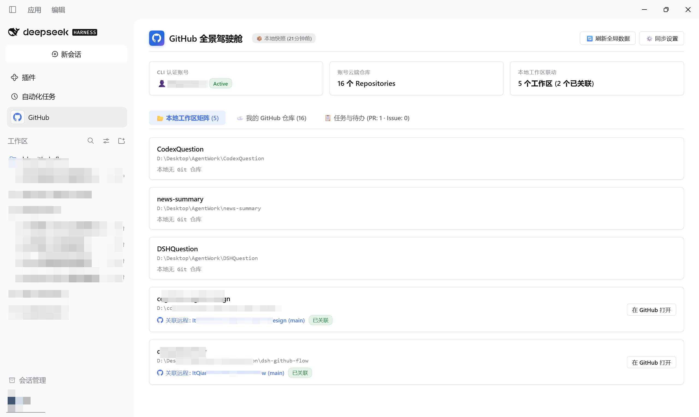
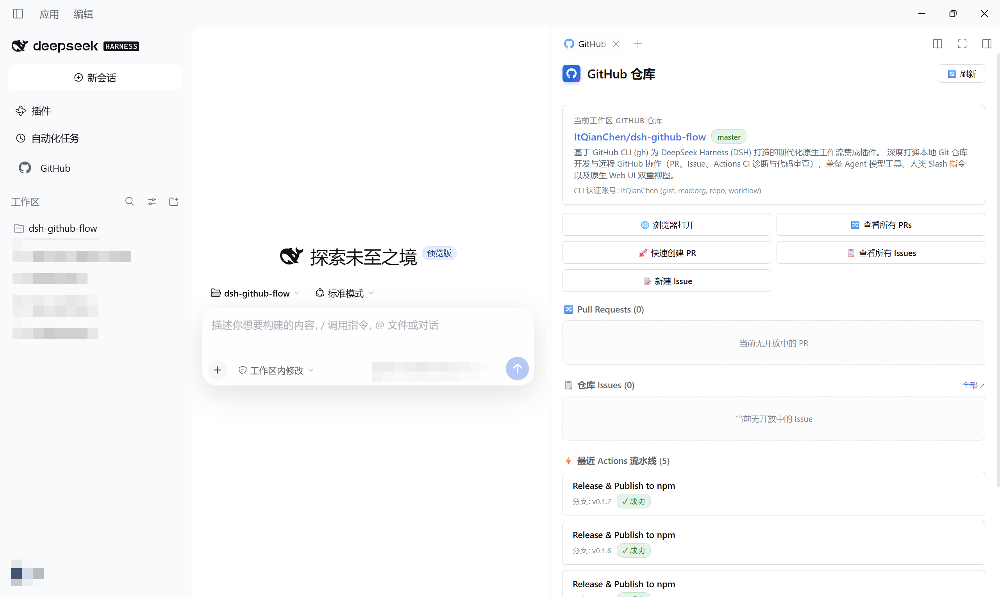
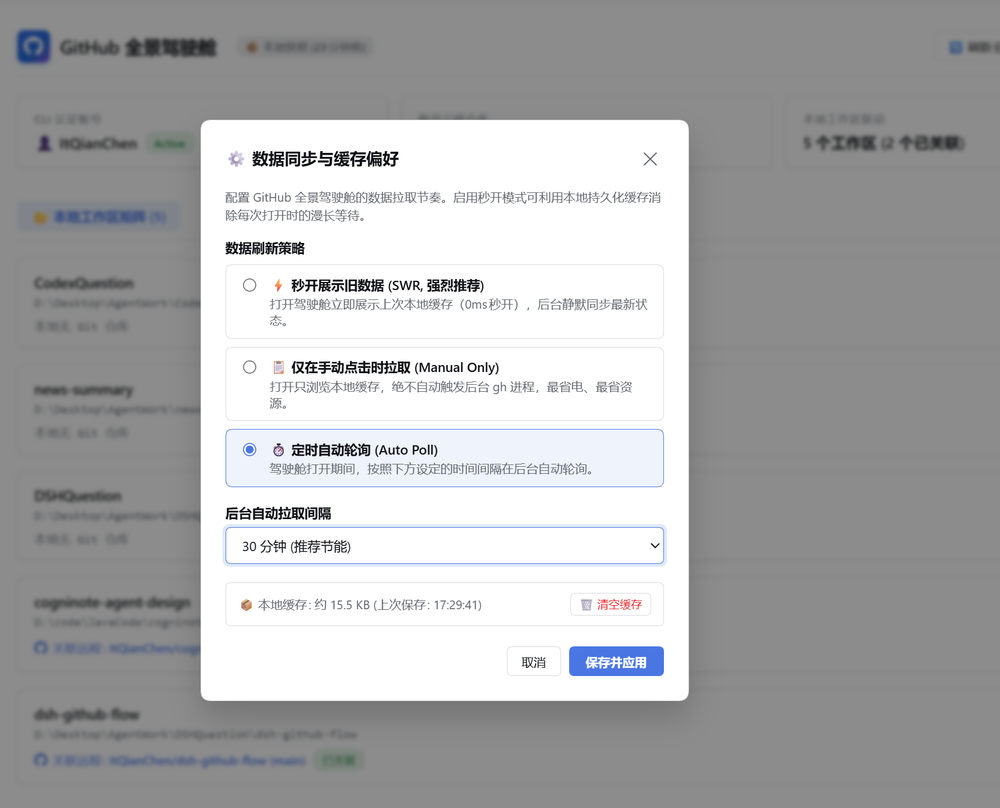

# DSH GitHub Flow (`dsh-github-flow`)

<p align="center">
  <a href="https://www.npmjs.com/package/dsh-github-flow"></a>
  <a href="https://www.npmjs.com/package/dsh-github-flow"></a>
  <a href="./LICENSE"></a>
  <a href="https://deepseek-harness.github.io/deepseek-harness/"></a>
  
</p>

<p align="center">
  <b>让 DeepSeek Harness Agent 拥有操作 GitHub 的原生手和脚，为人机协作打造沉浸式 GitHub 工作台。</b><br>
  原生复用宿主机 <code>gh</code> CLI 安全登录凭据，告别 Personal Access Token 泄露；深度打通本地 Git 工作区与云端仓库协作，兼具 <b>9 大领域 Agent 核心工具</b>、<b>人类 Slash 快捷指令</b>、<b>Web UI 全景工作台</b> 与 <b>一键自动跨平台无缝升级</b>。
</p>

<p align="center">
  <b>简体中文</b> | <b><a href="./README.en.md">English</a></b>
</p>

---

## 🎯 为什么需要 `dsh-github-flow`？

在日常使用 AI Agent 辅助编程与工程研发时，开发者经常遭遇以下断层痛点：

| 研发协作场景 | 传统方式（痛点重重） | `dsh-github-flow`（原生体验） |
| :--- | :--- | :--- |
| **Agent 提 PR & 代码评审** | 用户必须手动在网页复制分支、点开 GitHub 网页点鼠标提交 PR，无法实现自主研发闭环。 | **Agent 原生提单与评审**：对 Agent 说“帮我把当前分支提个 PR”，Agent 调用 `github_pr` 自动完成提交与代码 diff 审查。 |
| **CI / Actions 构建报错修复** | 构建挂了后，开发者在网页翻几十页 Actions 日志，复制报错贴给 Agent 调试。 | **精准抓取报错**：对 Agent 说“看下 CI 为什么失败”，Agent 调 `github_run(log_failed)` 秒级定位失败步骤并自动修复代码。 |
| **安全性与鉴权维护** | 必须在插件配置文件里贴明文 GitHub Token（PAT），面临权限失控与密钥泄漏风险。 | **0 密钥泄露风险**：直接复用机器本地已认证的 `gh auth login` 凭据，使用系统安全 Keyring。 |
| **多任务切屏困扰** | 必须在 VS Code、浏览器 GitHub 标签页和 DSH 聊天窗之间反复切屏，上下文频繁丢失。 | **内置沉浸式全景工作台**：DSH 内部常驻 PR 门禁、CI 流水线、三维待办 Issue 矩阵，一目了然。 |
| **首屏加载与性能等待** | 每次打开全景驾驶舱全屏白屏卡死转圈 8~15 秒，等待所有网络与子进程请求返回。 | **SWR 0ms 瞬间秒开**：打开立即呈现本地持久化快照，后台静默重验；提供专属设置面板自主调节拉取间隔与纯手动模式。 |
| **插件维护与升级** | 插件更新全靠开发者去 npm 碰运气看版本号，命令复杂不敢升。 | **闲时静默探测 + Web 一键自动升级**：双源极速探测，自动适配 Mac/Windows 跨平台命令，界面点击即升。 |

---

## 🤖 核心工具集 (Agent Tools)：给 Agent 装上 GitHub 的手和脚

本插件精选聚合为 **9 大领域核心工具**，拒绝几十个无用微型工具撑爆 Agent 上下文，原生搭载 **Token 防溢出保护（默认 24KB 智能二分截断）**、**高密度 Markdown 原生渲染（列表输出压缩 70%+ Token）** 与 **零参数 CWD 智能绑定**。

### 1. `github_pr`：PR 全生命周期管理与自动化代码审查
> **典型对话指令**：
> - *"帮我检查当前仓库有没有需要我审查的 PR？"*
> - *"帮我把当前特性分支创建一个 PR，标题叫 'feat: add dark mode'，附带简明改动说明"*
> - *"审查 PR #12 的代码差异并给出安全重构建议"*
> - *"检查 PR #8 的 CI 检查通过了吗？通过的话帮我 Squash 合并并删除源分支"*

* **支持操作 (`action`)**：
  * `list`：列出当前仓库开放的 PR（带作者、审查判定、CI 门禁状态，支持 `state` / `author` / `limit` 过滤）；
  * `view`：查看指定 PR 详情、描述与元数据；
  * `diff`：获取 PR 的完整代码差异（`stat_only` 仅看文件变更概览，防大 PR 溢出）；
  * `checks`：审查指定 PR 的 CI 门禁状态与检查套件结果；
  * `create`：一键自动创建 PR（支持 draft 草稿模式与 `--dry-run` 预演）；
  * `checkout`：🆕 把 PR 代码检出到本地分支，Agent 可直接在沙箱跑测试验证改动；
  * `status`：🆕 查看当前分支关联 PR 的合并冲突状态（`CLEAN` / `CONFLICT`）；
  * `review`：提交代码审查意见（`APPROVE`, `REQUEST_CHANGES`, `COMMENT`）；
  * `merge`：自动执行合并（支持 `squash` / `merge` / `rebase`，可指定 `delete_branch`；需 `confirm: true` 二次确认）。

---

### 2. `github_run`：CI 流水线排查与失败定位神器（Agent 自动修 Bug 核心）
> **典型对话指令**：
> - *"最近一次 Actions 工作流为什么挂了？提取失败步骤日志并帮我修复"*
> - *"看一下当前仓库最近 5 次 CI 构建的状态"*
> - *"重新运行刚才失败的工作流"*

* **支持操作 (`action`)**：
  * `log_failed`（🔥 **核心杀手锏**）：**专供 Agent 快速诊断**，自动抓取并剥离无关日志，精准提取失败 Step 的关键错误堆栈，供 Agent 直击问题修复代码；
  * `list`：查看当前仓库的 Workflow 运行历史与结论（支持 `branch` / `status: failure` 快速锁定失败构建）；
  * `view`：查看指定 run_id 的详细阶段（Jobs & Steps）；
  * `trigger`：🆕 主动触发 `workflow_dispatch` 工作流（提交修复后立即验证远端 CI）；
  * `rerun`：重新触发失败的 CI 运行；
  * `cancel`：取消在途的工作流。

---

### 3. `github_issue`：缺陷跟踪与待办任务闭环
> **典型对话指令**：
> - *"把刚才复现的内存泄漏 Bug 提一个 Issue，打上 'bug' 和 'backend' 标签"*
> - *"查看指派给我的所有待办 Issue"*
> - *"给 Issue #45 追加评论：'已经在 master 分支修复，等待发版验证'"*
> - *"把 Issue #45 关闭"*

* **支持操作 (`action`)**：
  * `list`：多条件检索 Issue 列表（`state` / `labels` / `assignees` / `limit`）；
  * `view`：查看 Issue 正文与评论历史；
  * `create`：创建新 Issue（支持标题、正文、标签、指派人）；
  * `edit`：🆕 修改标题、正文与增删标签；
  * `develop`：🆕 从 Issue 一键切出关联开发分支并本地检出，打通「读需求 → 写代码」闭环；
  * `comment`：在指定 Issue 中追加排查进展或评论；
  * `close`（需 `confirm: true`）/ `reopen`：开启或关闭 Issue。

---

### 4. `github_repo`：仓库探索与跨代码库检索
> **典型对话指令**：
> - *"在当前关联的 GitHub 仓库里搜索使用到 'createPrTool' 的代码行"*
> - *"在 GitHub 上检索关于 'dsh-plugin' 的优秀开源项目"*
> - *"查看仓库 cli/cli 的基本信息与星标数"*

* **支持操作 (`action`)**：
  * `view`：查看当前或目标仓库的元数据（默认分支、星标、描述、Topics 与开源协议）；
  * `sync`：🆕 一键拉平 Fork 仓库与上游主干，解决贡献开源项目时 Fork 落后导致 CI 门禁失败；
  * `search_code`：跨仓库或当前仓库检索特定代码符号；
  * `search_repos`：跨全站检索 GitHub 开源仓库。

---

### 5. `github_api`：底层的灵活“逃生门”
> **典型对话指令**：
> - *"调用 GitHub API 获取当前仓库最新的 Release 列表，用 jq 提取 tag 名称"*

* **核心优势**：直接复用本地认证环境调用任意 REST / GraphQL API，支持 `--jq` 预过滤、`raw` 原始响应模式与 `paginate` 自动翻页聚合，绝不因插件未封装特定接口而受限。

---

### 6. `github_release`：版本发布与构建资产交付 🆕
> **典型对话指令**：
> - *"给当前仓库发布 v0.2.0 版本，自动根据提交记录生成发版说明"*
> - *"把刚打好的 dsh-github-flow-0.2.0.tgz 上传到 v0.2.0 Release"*

* **支持操作 (`action`)**：
  * `list` / `view`：查看发版历史与任意版本详情（资产清单、发版说明）；
  * `create`：创建 Release（`generate_notes` 自动生成说明、`draft` / `prerelease` 标记、可直接附带资产）；
  * `upload` / `download`：上传 `.tgz` 等构建产物或按 glob 下载资产；
  * `delete`（需 `confirm: true`）：删除 Release，可选连 Tag 一起清理。

---

### 7. `github_secret`：CI/CD 部署密钥安全管理 🆕
> **典型对话指令**：
> - *"帮我把新的 NPM_TOKEN 更新到当前仓库的 Secrets 里"*
> - *"看一下这个仓库配了哪些密钥"*

* **支持操作 (`action`)**：
  * `list`：查看密钥名称清单（仅名称与更新时间，GitHub API 设计上不允许读取密文）；
  * `set`：设置/更新密钥值——**密文经子进程标准输入传递，绝不出现在命令行参数（防 `ps` 窃取），输出永不回显**；
  * `delete`（需 `confirm: true`）：删除密钥。
  * 支持仓库 / 组织 (`org`) / 环境 (`env`) 三级作用域与 `actions` / `codespaces` / `dependabot` / `agents` 应用归属。

---

### 8. `github_skill`：跨 Agent 开源 Skills 生态发现 🆕
> **典型对话指令**：
> - *"在 GitHub 上搜一下有没有关于 code-review 的 Agent Skill"*
> - *"预览一下那个 Skill 的内容，合适就装到当前项目"*

* **支持操作 (`action`)**：
  * `search`：基于 GitHub Code Search 跨仓库检索开源 `SKILL.md` 技能（带 Stars 排序）；
  * `preview`：只读预览 Skill 内容，安装前审阅行为约束，不落盘；
  * `install`（需 `confirm: true`）：安装到本地 Agent 宿主（Claude Code / Cursor / Copilot 等 50+），支持 `project` / `user` 两种范围；
  * `list`：查看本机已安装的全部 Skills。
  * 依赖 GitHub CLI 2.9x+ 的 `gh skill` 官方 preview 特性。

---

### 9. `github_help`：元指南与故障自愈中枢 🆕
> **典型对话指令**：
> - *"我不确定该用哪个 GitHub 工具做这件事"*
> - *"GitHub 搜索的高级语法怎么写？"*

* **核心能力**：
  * 9 大工具任务路由导航（「什么任务调什么工具」一查便知）；
  * 官方高级检索语法速查（日期区间、状态修饰符、代码搜索范围限定）；
  * 常见故障自愈配方（403 限流、422 参数缺失、Fork 落后拉平、CLI 版本过低）；
  * 直接透传 `gh help <command>` 官方离线手册。

---

## 🛡️ 安全防线设计

* **高危操作双重确认**：`merge`、`close`、`release delete`、覆盖上传 (`clobber`)、`secret delete`、`skill install` 等不可逆或写盘操作强制要求 `confirm: true` 参数；未确认时只返回影响评估报告，绝不执行。杜绝模型幻觉导致的意外合并或删除。
* **密文标准输入通道**：`github_secret` 的密钥值经子进程 stdin 传递，全程不出现在命令行参数（防 `ps` / 任务管理器窃取）、不落盘、不在输出中回显；gh 在本地用仓库公钥加密后才上传。
* **命令注入免疫**：所有 gh 调用采用 `execFile` 数组参数隔离执行，零 Shell 字符串拼接。

---

## 🖥️ 原生 Web UI 沉浸式工作台与同步设置

### 1. 全局全景驾驶舱 (Global Cockpit)

点击 DSH 左侧主导航的 GitHub 图标进入：
* **⚡ 0ms 瞬间秒开直出 (SWR 本地持久化缓存)**：利用客户端本地持久化快照，告别每次进入转圈等待 8~15 秒的烦躁感，打开瞬间完整渲染全部卡片与列表；
* **📦 实时数据新鲜度胶囊**：标题栏旁直观展示数据状态（`[📦 本地快照 (21分钟前)]` ➔ `[⏳ 后台同步中...]` ➔ `[✅ 已是最新 (15:30)]` ➔ `[⚠️ 同步超时已保留缓存]`）；
* **账号全景概览**：实时透视名下所有 GitHub 仓库、默认分支与 Star 状态；
* **本地工作区联动矩阵**：自动探测本机所有打开的项目，显示当前工作区与远程 GitHub 仓库的关联状态；
* **三维待办 Issue 矩阵**：智能划分「📥 用户提单（反馈到我名下仓库）」、「🎯 指派待办（分配给我）」与「✍️ 我发起的」，支持一键药丸过滤；
* **升级提示横幅**：检测到新版本时在顶部优雅滑出，提供一键自动升级与更新日志直达。

<p align="center">
  
</p>

### 2. 会话右侧栏工作区面板 (Session Workspace Panel)
位于每个对话工作区的右侧抽屉栏：
* **当前仓库上下文绑定**：自动锁定当前会话的 Git 仓库，无需选择；
* **数据新鲜度胶囊对齐**：标题旁紧凑呈现 `[📦 本地快照 (2分钟前)]` 与 `[🔄 刷新]` 按钮，与主页规则 100% 保持一致，首屏 0ms 瞬间直出；
* **PR 门禁状态药丸**：展示当前开放 PR，悬停查看 Checks 结果与审核意见；
* **当前仓库 Open Issues 列表**：直接在侧边栏审查待办任务并提供直达链接；
* **最新 Actions 构建流水线**：实时关注 CI 状态；
* **快捷操作网格**：一键在浏览器打开仓库、直达 Issues/PRs、一键创建 PR。

<p align="center">
  
</p>

### 3. 数据同步与缓存偏好设置 (Sync Settings Modal)
点击全景驾驶舱右上角 **`[⚙️ 同步设置]`** 即可随时调优数据拉取节奏：
* **三种刷新策略随心选**：
  * **⚡ 秒开模式 (SWR, 推荐)**：打开驾驶舱立即展示上次本地缓存（0ms秒开），后台静默同步最新状态；
  * **📋 仅在手动点击时拉取 (Manual Only)**：打开只浏览本地缓存，绝不自动触发后台 gh 进程，最省电、最省资源；
  * **⏱️ 定时自动轮询 (Auto Poll)**：驾驶舱打开期间，按照设定间隔在后台自动轮询。
* **自定义后台拉取间隔**：支持选择 1 分钟 / 5 分钟 (默认) / 15 分钟 / 30 分钟 (推荐节能) / 1 小时 / 从不自动刷新；
* **本地缓存可视化管理**：透明查看本地快照体积与保存时间戳，支持一键 `[🗑️ 清空缓存]` 重置。

<p align="center">
  
</p>

---

## 🚀 安装指南

### 步骤 1：前置准备（若已安装可跳过）
确保你的机器上已安装 GitHub CLI (`gh`) 并已登录：
```bash
# Windows 安装
winget install --id GitHub.cli

# macOS 安装
brew install gh

# 登录认证（仅需执行一次）
gh auth login
```

### 步骤 2：安装插件到 DSH

在 DSH 终端根据你的使用环境执行对应命令：

```bash
# 场景 A：DSH 桌面版 (Desktop Profile)
dsh plugin --profile desktop add dsh-github-flow

# 场景 B：DSH Web / CLI 工程环境
pnpm dsh plugin add dsh-github-flow
```

> 💡 **提示（新版本发布后 24 小时内的安全锁定期说明）**：  
> DSH 内置包管理器默认启用了防投毒的供应链安全策略（`minimum-release-age = 24h`）。新版本发布后的 **24 小时内**，若执行不带版本号的裸名安装命令，底层会自动回退为发布满 24 小时的上一稳定版本。如需**立即尝鲜刚发布的新版本**，请在命令末尾显式指定版本号：
> ```bash
> dsh plugin --profile desktop add dsh-github-flow@0.1.8
> ```
> 版本发布满 24 小时后，执行原本的裸名命令即可默认解析安装最新版。

---

## ⚡ 智能升级与版本检查机制

再也不用担心错过新功能！`dsh-github-flow` 内置了工业级的版本管理机制：

1. **业务优先，闲时静默后置**：
   - 打开 Web 界面时，**核心 PR / Issue 数据 100% 毫秒级优先拉取渲染**；
   - 在所有业务数据渲染就绪后，前端延迟 1.5 秒利用空闲时间发起后台探针，**对主业务 0 阻塞、0 抢占**。
2. **国内双源智能加速**：
   - 默认第一顺位走 **阿里云/淘宝 npm 镜像**（国内延迟仅 50~150ms），超时自动无缝回退官方 npmjs 兜底。
3. **跨平台一键自动升级**：
   - **界面直升**：在全景驾驶舱或右侧栏点击 **`[⚡ 一键自动升级]`**，插件在后台安全执行拉取；
   - **智能适配**：自动识别 macOS、Windows 与桌面版 Profile，Mac 环境下自动补全 Homebrew 环境变量；
   - **源码保护防线**：检测到本地 Git 源码软链接模式（`link:`）时自动阻止覆盖，防止破坏开发工作区；
   - **成功自愈提示**：升级成功后明确提醒重启 DSH 服务以激活后端新工具，也可点击按钮立即刷新页面预览新界面。

---

## ⏱️ SWR 秒开缓存与数据拉取节奏控制

为什么以前打开全景驾驶舱需要等待好几秒？因为全景数据要并发调用十余次 `gh` 进程扫描多个仓库与工作区。本插件引入了 **Stale-While-Revalidate (SWR)** 缓存体系，并把控制权完全交还给用户：

```
首次渲染 (0ms) ──────────> 恢复本地持久化快照，瞬间完整上屏
                                │
                                ├── SWR 模式: 延迟 300ms 后台静默拉取，平滑对齐最新数据
                                ├── 手动模式: 仅浏览本地快照，点击「🔄 刷新」才发起拉取
                                └── 轮询模式: 按设定间隔 (如 5m/30m) 自动后台轮询
```

### 三种刷新策略对比与选用建议：

| 刷新模式 | 运行机制 | 适用人群与场景 |
| :--- | :--- | :--- |
| **⚡ 秒开模式 (SWR, 默认)** | 打开驾驶舱 **0ms 立即呈现** 上次保存的本地离线快照，随后后台静默更新。 | **强烈推荐所有开发者**。消灭白屏转圈，体验最顺畅丝滑。 |
| **📋 仅手动刷新 (Manual Only)** | 仅浏览本地已有数据，绝对不自动发起任何后台 `gh` 网络拉取。 | **笔记本电池供电、低配设备或弱网环境**。极致节能，杜绝无谓后台开销。 |
| **⏱️ 定时自动轮询 (Auto Poll)** | 打开驾驶舱后，按照选定的时间间隔（1m~1h）在后台自动轮询。 | **维护者工作站、实时监控大屏**。始终保持第一手待办同步。 |

* **离线韧性保障 (Fail-Safe)**：即使完全断网或后台请求超时，**界面依然完整保留本地快照供您浏览与检索，绝不发生白屏或红字崩溃报错！**

---

## 💬 人类 Slash 指令速查

在 DSH 任意聊天窗口输入：

* `/gh status`：一键诊断当前 GitHub CLI 账号认证状态、作用域、当前工作区关联仓库及插件版本；
* `/gh upgrade`：主动检测 npm 最新版本，自适应输出当前操作系统（macOS / Windows / Linux）的最佳升级指引；
* `/gh help`：查看帮助说明与 Agent 典型对话范例。

---

## ⚙️ 配置项说明 (`cordis.patch.yml`)

插件具备开箱即用的默认行为，也可在 `cordis.patch.yml` 或 Profile 中按需调优：

```yaml
- insert:
    - id: github-flow
      name: dsh-github-flow
      config:
        ghPath: 'gh'              # GitHub CLI 可执行程序路径（内网特定环境可指定绝对路径）
        defaultTimeoutMs: 30000   # 命令执行超时时间（毫秒，默认 30 秒）
        maxOutputChars: 24000     # 单次命令安全返回字符数上限（Token 防溢出保护）
        maxOutputBytes: 96000     # 单次命令 UTF-8 字节数硬上限，默认 maxOutputChars × 4
        defaultListLimit: 20      # 列表类查询默认返回条数（pr/issue/run/release/skill 通用）
        cacheTtlMs: 15000         # 单仓库概览缓存时长（毫秒，默认 15 秒）
        checkUpdate: true         # 是否开启新版本自动检查提示（默认开启）
        updateCheckIntervalMs: 86400000 # 检查更新间隔（毫秒，默认 24 小时）
        registryUrl: ''           # 自定义私有 npm 镜像地址（留空则自动选用 npmmirror 与 npmjs）
```

---

## 🔌 生态服务扩展 (Cordis Service)

本插件提供标准 Cordis 原生服务 `ctx.github`。其他 DSH 插件只需声明依赖即可复用：

```typescript
import type { Context } from '@deepseek-ai/cordis';

export const inject = ['github'];

export function apply(ctx: Context) {
  // 直接调用经过安全包装的底层执行引擎
  const auth = await ctx.github.checkAuth();
  const repo = await ctx.github.getRepoMetadata();
  const prs = await ctx.github.run(['pr', 'list', '--json', 'number,title']);
}
```

---

## 📚 相关开发文档

- [npm 发布与自动化 CI 发版指南](./docs/npm-publish-guide.md)
- [架构设计与技术规范](./docs/architecture.md)


---
## 友情链接

- [LINUX DO - 新的理想型社区](https://linux.do/)

---

## 📄 开源协议 (License)

本项目基于 [MIT License](./LICENSE) 协议完全开源。欢迎提交 PR 与 Issue！
